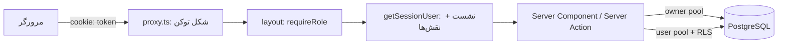

# معماری نرم‌افزاری سامانه جامع آموزشی آفاق (دیدگاه نرم‌افزاری)

> تاریخ تهیه: ۱۴۰۵/۰۷/۲۱ (2026-10-13) · شاخه `FINAL` · Next.js 16 + React 19 + Drizzle ORM + PostgreSQL 16 + Redis
> این سند «دیدگاه نرم‌افزاری» کل سامانه است: کد چطور نوشته شده و هر چیز به چه ربط دارد.
> راهنمای کاربری تصویری (۴۰+ اسکرین‌شات واقعی) در مرکز راهنمای داخل سامانه (`/help`) است.

## نقشه سند

| بخش | فایل | محتوا |
|---|---|---|
| ۱. شالوده، احراز هویت، داده | [`architecture/01-foundation.md`](architecture/01-foundation.md) | استک، چیدمان ریپو، مهاجرت‌ها، دیتابیس و RLS، نشست و نقش‌ها، چنددانشگاهی و ترم، تنظیمات، قراردادها |
| ۲. پورتال دانشجو | [`architecture/02-student.md`](architecture/02-student.md) | پوسته، ۱۲ صفحه، موتورها (ثبت‌نام، کارنامه، مالی، کارت آزمون)، دمو |
| ۳. پورتال استاد | [`architecture/03-professor.md`](architecture/03-professor.md) | پوسته، ۹ صفحه، داده و تقویم، حضور/نمرات، جلسات، حقوق و قرارداد |
| ۴. ادمین، موتورها، یکپارچه‌سازی‌ها | [`architecture/04-admin-engines.md`](architecture/04-admin-engines.md) | ۲۸ ناحیه ادمین، ثمین، موتور زمان‌بندی/ثبت‌نام/فراغت، کرون‌ها، راهنما |

## سامانه در یک نگاه

| لایه | فناوری / قرارداد |
|---|---|
| فریم‌ورک | Next.js 16 App Router (React 19)، رندر غالباً سروری (`force-dynamic`)، فارسی راست‌به‌چپ با فونت وزیرمتن |
| دیتابیس | PostgreSQL 16؛ اسکیما در `src/db/schema.ts`؛ مهاجرت‌های نسخه‌دار `drizzle/*.sql` با دفتر `_journal.json`؛ کاربر محدود `afagh_app` با RLS + `withUserRls` |
| کش/صف | Redis (صندلی اتمیک ثبت‌نام، نشست‌ها)؛ MinIO (فایل‌ها، عکس با `photoKey`) |
| احراز هویت | نشست sha256 در جدول `sessions` (کوکی `token`) + نقش‌ها (`user_roles`)؛ حالت دمو opt-in با قفل build-time |
| چنددانشگاهی | کوکی `afagh_uni` (پیش‌فرض آفاق)؛ ترم با کوکی `afagh_term` + تشخیص تاریخ‌محور ترم جاری |
| تاریخ | جلالی بدون ICU (`lib/calendar.ts`)؛ مبنای روز هفته **۰=شنبه … ۶=جمعه** (مطابق سما) |
| تست | `tests/*.test.ts` با `tsx` (دستور `npm test`)؛ تایپ‌چک `tsc --noEmit` |
| استقرار | ایمیج‌های `afagh-app` و `afagh-migrator`؛ `make migrate` (پشتیبان + مهاجرت + seed + سخت‌سازی) |

## چرخه یک درخواست (خلاصه)

## اسکرین‌شات‌های واقعی مرکز راهنما

۴۳ تصویر واقعی از سامانهٔ در حال اجرا در `afagh-next/public/help/<role>/<slug>-<n>.png` قرار دارد و کامپوننت `HelpScreenshot` اول PNG، بعد SVG، و در نهایت جای‌نما را نشان می‌دهد. فهرست کامل:

| نقش | موضوعات |
|---|---|
| دانشجو (۱۸) | dashboard-1/2، term-filter-1/2، account-switch-1/2، chart، transcript، enroll-1/2، schedule، exam-card، finance، documents، requests، thesis-proposal، virtual-classes، graduation |
| استاد (۱۱) | dashboard، term-filter، schedule، attendance، grades-1/2، availability، performance، evaluation، contract، documents |
| مدیر گروه (۴) | offerings، courses، classrooms، equivalence |
| ادمین (۶) | terms، curriculum، universities، samin، finance، staff |
| عمومی (۴) | login، password، account-switch، using-help |
