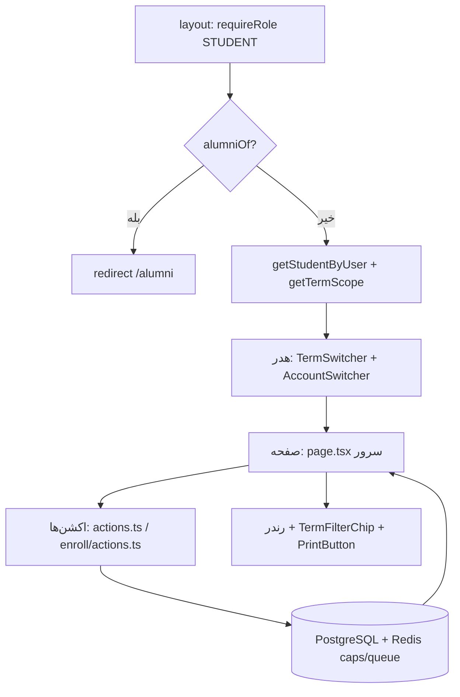
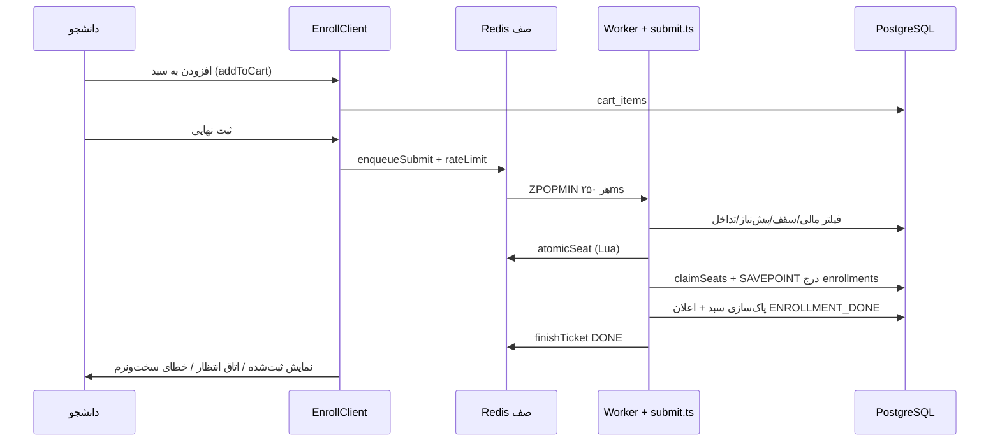

# بخش ۲ — پورتال دانشجو (`src/app/student/**`)

> دامنه: Next.js 16 App Router، رابط فارسی راست‌به‌چپ، شاخهٔ `FINAL`. همهٔ ارجاع‌ها به همین ریپو هستند.

## ۱) پوسته (Shell): `layout.tsx`

- گیت نقش: `requireRole(['STUDENT'])` در `src/app/student/layout.tsx:17`؛ نقش `ADMIN` هم همیشه مجاز است (`src/lib/auth.ts:571`).
- ریدایرکت دانش‌آموختگان: اگر `alumniOf(user.id)` رکورد `GRADUATED` برگرداند → `redirect('/alumni')` (`src/app/student/layout.tsx:20`، تعریف در `src/lib/alumni.ts:37-51`).
- حل پروندهٔ دانشجویی: `getStudentByUser(user.id)` (`src/app/student/layout.tsx:22`)؛ انتخاب `ACTIVE` اول بعد جدیدترین (`src/lib/auth.ts:597-602`)؛ خودترمیم دمو در همان تابع (`src/lib/auth.ts:604-617`).
- دانشگاه از ردیف دانشجو می‌آید: `me?.universityId` به `getTermScope` داده می‌شود (`src/app/student/layout.tsx:24`)؛ نه از `users.universityId`.
- هدر: `bg-emerald-800`، چسبان (`sticky top-0 z-40`)، `print:hidden` (`src/app/student/layout.tsx:37`)؛ شامل نام سامانه + `user.name` (`src/app/student/layout.tsx:44-45`).
- `TermSwitcher` داخل هدر با `terms/selectedId/effectiveId/universityId` (`src/app/student/layout.tsx:49-54`)؛ منطق اسکوپ در `src/lib/term-scope.ts:216-234` (کوکی `afagh_term`، سقف `TERM_SWITCHER_LIMIT=30` در `src/lib/term-scope.ts:10`).
- لینک‌های راهنما `/help/student` و `/help/pdfs/student.pdf` (`src/app/student/layout.tsx:55-69`)؛ دکمهٔ «پنل استاد» فقط اگر `user.roles` شامل `PROFESSOR` باشد (`src/app/student/layout.tsx:71-80`).
- `ThemeToggle` و فرم خروج با `logoutAction` (`src/app/student/layout.tsx:81-86`).
- `AccountSwitcher` با `siblings=getSiblingAccounts()` زیر هدر، قبل از بدنهٔ دو‌ستونه (`src/app/student/layout.tsx:29` + `src/app/student/layout.tsx:92`)؛ خطای آن با `catch(()=>[])` بلعیده می‌شود (`src/app/student/layout.tsx:29`).
- بدنه: `max-w-7xl` با `flex-col md:flex-row` (`src/app/student/layout.tsx:93`)؛ سایدبار دسکتاپ `StudentSidebar` با `user={{name, studentCode}}` (`src/app/student/layout.tsx:95`)؛ محتوای اصلی `main` با `pb-24 md:pb-8` برای جا دادن ناوبری موبایل (`src/app/student/layout.tsx:98-100`).
- ناوبری موبایل `StudentNav` ثابت پایین، فقط `md:hidden` (`src/app/student/StudentNav.tsx:98`)؛ فقط ۵ آیتم اول (`src/app/student/StudentNav.tsx:100`).
- سایدبار: `hidden md:flex`، عرض `w-64 lg:w-72`، چسبان `top-[65px]`، `print:hidden` (`src/app/student/StudentNav.tsx:26`)؛ تایل پروفایل با حرف اول نام + شمارهٔ دانشجویی (`src/app/student/StudentNav.tsx:28-40`).
- آیتم‌های ناوبری (`NAV_ITEMS`) در `src/app/student/StudentNav.tsx:7-20`: داشبورد، انتخاب واحد (بج `Redis`)، کارت آزمون، کارنامه، مالی، کلاس آنلاین (بج `BBB`)، برنامهٔ هفتگی، چارت، درخواست‌ها، مدارک، فارغ‌التحصیلی، پایان‌نامه.
- فعال‌بودن لینک: `exact` فقط برای `/student`، بقیه `startsWith` (`src/app/student/StudentNav.tsx:48`)؛ استایل فعال `bg-emerald-700` (`src/app/student/StudentNav.tsx:55`).
- کد دانشجویی سایدبار در حالت دمو از `DEMO_STUDENT.studentCode` می‌آید نه از دیتابیس (`src/app/student/layout.tsx:26` + `src/lib/demo-student-data.ts:51-53`).
- قفل بیکاری: `SessionLock` با `SESSION_LOCK_MINUTES` پیش‌فرض ۱۵ (`src/app/student/layout.tsx:32` + `src/app/student/layout.tsx:105`).
- جهت کل پوسته `dir="rtl"` روی `div` ریشه (`src/app/student/layout.tsx:35`)؛ همهٔ صفحات فرزند همین جهت را به ارث می‌برند.
- کوکی ترم: نام `afagh_term` (`src/lib/term-scope.ts:6`)؛ خواندن در `getTermScope` (`src/lib/term-scope.ts:226`) و نوشتن از `setTermCookie` در `TermFilterChip` (`src/app/student/term-filter-chip.tsx:22`).
- `TermFilterChip` فقط دکمهٔ «پاک کردن فیلتر» دارد و کلاس `print:hidden` (`src/app/student/term-filter-chip.tsx:31-42`)؛ `TermFilterNote` متن «اعمال نمی‌شود» دارد (`src/app/student/term-filter-note.tsx:1-7`).
- `getSiblingAccounts` برای بنر جابه‌جایی حساب‌های هم‌کدملی است (`src/app/student/layout.tsx:28`)؛ «تأییدنشده»: جزئیات داخلی `AccountSwitcher` در این بازبینی خوانده نشد.
- تمام صفحات دانشجو `dynamic='force-dynamic'` هستند؛ نمونه: داشبورد (`src/app/student/page.tsx:36`)، چارت (`src/app/student/chart/page.tsx:23`)، کارنامه (`src/app/student/transcript/page.tsx:16`).
- ریشهٔ احراز هویت نشست: کوکی `token` با TTL چهارساعته و تمدید لغزشی (`src/lib/auth.ts:51-52` + `src/lib/auth.ts:96-105`)؛ کاربر غیرفعال نشستش باطل می‌شود (`src/lib/auth.ts:92-95`).
- صورت‌های مالی داشبورد از همان `getExamCardData` می‌آیند، نه از `finance-engine` (`src/app/student/page.tsx:102` + `src/app/student/page.tsx:287-291`).

## ۲) صفحه‌ها

### ۲-۱) داشبورد `src/app/student/page.tsx` — مسیر `/student`

- گارد + حل پرونده: `requireRole` و `getStudentByUser` (`src/app/student/page.tsx:51-53`)؛ پیام «پروندهٔ دانشجویی یافت نشد.» اگر `me` تهی (`src/app/student/page.tsx:53`).
- ترم: `getTermScope(me.universityId)` + `resolveDashboardTerm` (`src/app/student/page.tsx:55-59`؛ تعریف در `src/lib/student-dashboard-helpers.ts:100-108`) — ترم نمایشی = فیلتر انتخابی، وگرنه ترم مؤثر.
- شمارهٔ ترم تحصیلی از `termOrdinalForEntry` با `entryYear/entryTerm` (`src/app/student/page.tsx:62-70`؛ تعریف در `src/lib/term-scope.ts:248-268`)، نه ستون `currentTermNo`.
- شاخهٔ دمو: اگر `isDemoStudentUser` → فقط `<DemoDashboard>` (`src/app/student/page.tsx:72-74`؛ کامپوننت در `src/app/student/demo-sections.tsx:34-346`).
- کلیدهای مدیر: `ENROLLMENT_WINDOW_OPEN` و `EMERGENCY_WITHDRAW_OPEN` (`src/app/student/page.tsx:77-80`).
- منابع داده (هم‌زمان با `Promise.all` در `src/app/student/page.tsx:84-154`): رشته (`majors`)، مقطع (`degree_level_configs`)، چارت (`resolveStudentCurriculum`)، کارت آزمون (`getExamCardData`)، آیین‌نامه (`educational_regulations`)، رکورد کاربر (`users`)، همهٔ ثبت‌نام‌ها از مسیر `withUserRls`، معدل رسمی (`calculateOfficialGPA`)، ثبت‌نام‌های ترم جاری با وضعیت‌های `REGISTERED/FINALIZED/WAITLISTED/PENDING_COUNCIL/DROPPED`.
- کارت‌های متریک (۴ عدد در `src/app/student/page.tsx:309-439`): معدل کل (`officialGpaResult.gpa`)، واحدهای گذرانده در برابر `totalRequiredUnits` چارت، واحدهای ترم جاری (`currentUnitsTotal`)، وضعیت کارت آزمون (تسویه/بدهی از `examCard`).
- ویجت کلاس مجازی امروز از `virtual_classrooms` متصل به `course_offerings` ترم جاری (`src/app/student/page.tsx:201-221`)؛ نمایش حداکثر با لینک «ورود به کلاس» به `/student/virtual-classes` (`src/app/student/page.tsx:689-693`).
- آزمون‌های پیش‌رو: حداکثر ۳ درس دارای `examDate` با شمارهٔ صندلی از `examCard` (`src/app/student/page.tsx:228-244`).
- حذف اضطراری: فرم `emergencyDropFormAction` برای هر درس جاری (`src/app/student/page.tsx:798-807`)؛ اگر کلید بسته باشد بج «غیرفعال است» (`src/app/student/page.tsx:808-811`)؛ منطق در `src/app/student/actions.ts:79-155` (شرط `EMERGENCY_WITHDRAW_OPEN`، شرط پایان `addDropEndDate`، ست‌کردن `DROPPED + emergencyWithdrawal=1`).
- فیلتر ترم: `TermFilterChip` بالای صفحه اگر فیلتر فعال باشد (`src/app/student/page.tsx:248-250`).
- هیرو: گرادیان `emerald-900→teal-900→slate-900` با حرف اول نام، بج وضعیت (`statusFa` در `src/app/student/page.tsx:38-48`)، رشته/مقطع/ورودی (`src/app/student/page.tsx:255-304`).
- بنر `MessengerOnboardBanner` زیر چیپ فیلتر (`src/app/student/page.tsx:251`)؛ «تأییدنشده»: منطق داخلی آنبنر در این بازبینی خوانده نشد.
- نگاشت استاد: `buildProfNameMap` از `staff ⨝ users` (`src/app/student/page.tsx:167-177`؛ تعریف در `src/lib/student-dashboard-helpers.ts:27-33`).
- نگاشت زمان‌بندی: `buildDashboardScheduleMap` با اتاق پیش‌فرض «کلاس تئوری» و «سالن امتحانات مرکزی» (`src/lib/student-dashboard-helpers.ts:63-87`).
- دسترسی سریع: ۸ کارت لینک‌دار به انتخاب واحد/کارت/کارنامه/مجازی/برنامه/درخواست/چارت/مدارک (`src/app/student/page.tsx:452-629`)؛ بج‌های `Redis/QR/BBB` صرفاً نمایشی‌اند.
- مجموع واحد جاری از جمع `units` ثبت‌نام‌های ترم (`src/app/student/page.tsx:162`)؛ شناسه‌های یکتا با `distinctIds` (`src/app/student/page.tsx:164-165`؛ تعریف در `src/lib/student-dashboard-helpers.ts:110-112`).
- حذف معمولی `dropCourseAction`: فقط `REGISTERED`، با `releaseSeat` + ارتقای نفر اول `WAITLISTED` و اعلان `WAITLIST_PROMOTED` (`src/app/student/actions.ts:15-73`).
- اکشن فرمی `emergencyDropFormAction` پوشش `<form action>` برای Server Component است (`src/app/student/actions.ts:157-162`).

### ۲-۲) چارت `src/app/student/chart/page.tsx` — مسیر `/student/chart`

- شاخهٔ دمو → `<DemoChart>` (`src/app/student/chart/page.tsx:76-78`؛ تعریف در `src/app/student/demo-sections.tsx:348-454`).
- رشته/مقطع از `majors` و `degree_level_configs` (`src/app/student/chart/page.tsx:80-81`)؛ ترم مبنا = فیلتر انتخابی وگرنه `currentTermFor` (`src/app/student/chart/page.tsx:82`).
- سوابق: همهٔ `enrollments` دانشجو از `withUserRls` (`src/app/student/chart/page.tsx:84-101`)؛ تشخیص قبولی با `EQUIV_PASSED` یا نمره ≥ `minPassedMark` و حالت توصیفی (`DESCRIPTIVE` یا `affectsGpa=0`) (`src/app/student/chart/page.tsx:103-113`).
- حل نسخهٔ چارت: نسخه‌های رشته + دانشگاه، سپس `resolveApplicableCurriculum` با `majorId/degreeLevelId/entryYear` (`src/app/student/chart/page.tsx:115-145`؛ موتور در `src/lib/curriculum-resolution.ts:97-147`).
- ردیف‌های چارت از `curriculum_courses ⨝ courses` مرتب با `recommendedSemester, code` (`src/app/student/chart/page.tsx:152-168`)؛ پیش‌نیازها از `course_rules` نوع `PREREQ` با پارس `logicTree` (`src/app/student/chart/page.tsx:170-183` + تابع `prereqCodes` در `src/app/student/chart/page.tsx:47-63`).
- گروه‌بندی نمایشی بر اساس `recommendedSemester` با عنوان‌های فارسی (`semesterTitle` در `src/app/student/chart/page.tsx:35-45`)؛ ترم بدون پیشنهاد با کلید `0` (`src/app/student/chart/page.tsx:190-194`).
- برجسته‌سازی نیمسال انتخابی: `highlightSemesters` + اسکرول خودکار `TermAutoScroll` (`src/app/student/chart/page.tsx:201-208`).
- وضعیت هر درس: گذرانده / در حال گذران / اخذ‌نشده (ترم گذشته) / ترم‌های بعد (`src/app/student/chart/page.tsx:307-338`).
- حالت خالی صادقانه: «چارت برای این دانشجو تعریف نشده» + شمار سوابق واقعی (`src/app/student/chart/page.tsx:234-243`).

### ۲-۳) کارنامه `src/app/student/transcript/page.tsx` — مسیر `/student/transcript`

- منابع هویتی: `majors`، `degreeLevelId`، `users.nationalCode` (`src/app/student/transcript/page.tsx:35-37`)؛ کدملی همیشه ماسک‌شده با `maskNationalCode` (`src/app/student/transcript/page.tsx:65`؛ تعریف در `src/lib/verification.ts:50-57`).
- انتخاب آیین‌نامه: ترجیح رکورد منتسب در پنجرهٔ ورودی، وگرنه جدیدترین در پنجره (`src/app/student/transcript/page.tsx:46-55`)؛ سیاست معدل از `grading_and_gpa.failed_course_gpa_policy` (`src/app/student/transcript/page.tsx:58-60`).
- همهٔ سوابق از `withUserRls` با جوین `enrollments→offerings→courses→terms` مرتب با `termCode` (`src/app/student/transcript/page.tsx:75-103`).
- فیلتر ترم: فقط سطرهای `termId` برابر فیلتر (`src/app/student/transcript/page.tsx:106`) + نمایش `TermFilterChip` (`src/app/student/transcript/page.tsx:171-173`).
- مرتب‌سازی و گروه‌بندی: `sortTermsForTranscript` بعد `groupTermsByAcademicYear` (`src/app/student/transcript/page.tsx:125-132`؛ تعریف در `src/lib/scheduling-core.ts:139-196`)؛ بلوک معادل‌سازی (`EQUIVALENCE_GROUP_YEAR=0`) اول، بعد سال‌ها نزولی (`src/app/student/transcript/page.tsx:133-137`).
- معدل رسمی از `calculateOfficialGPA` (`src/app/student/transcript/page.tsx:140-145`)؛ معدل هر ترم به‌صورت وزنی روی نمرات ۰..۲۰ غیرتوصیفی (`src/app/student/transcript/page.tsx:290-311`)؛ آستانهٔ مشروطی نمایشی `<12` و ممتازی `≥17` در همین فایل (`src/app/student/transcript/page.tsx:312-313`).
- منطق نتیجهٔ هر سطر: حذف اضطراری / معادل / جاری / مردود / قبول (`src/app/student/transcript/page.tsx:361-382`)؛ نمرهٔ توصیفی به‌صورت «قبول» چاپ می‌شود نه عدد (`src/app/student/transcript/page.tsx:393-401`).
- سند چاپی: سربرگ سه‌ستونه، جدول هویت، بلوک‌های سال، جمع کل دوره، بنر حذف مردودی (`EXCLUDE_IF_PASSED` با `excludedCount`) (`src/app/student/transcript/page.tsx:187-462`)؛ دکمهٔ چاپ `PrintButton` در نوار `print:hidden` (`src/app/student/transcript/page.tsx:175-184`).
- حالت خالی: پیام متفاوت برای فیلتر فعال در برابر بدون سابقه (`src/app/student/transcript/page.tsx:258-264`).

### ۲-۴) انتخاب واحد `src/app/student/enroll/**` — مسیر `/student/enroll`

- صفحهٔ سرور (`src/app/student/enroll/page.tsx:32-43`): ترم از فیلتر وگرنه `isCurrent=1`؛ وضعیت آیین‌نامه از `evaluateStudentRegulationStatus` (`src/app/student/enroll/page.tsx:45-50`).
- ارائه‌ها: فقط `isActive=1` ترم جاری با جوین `courses` (`src/app/student/enroll/page.tsx:53-70`)؛ نام استاد از `staff ⨝ users` (`src/app/student/enroll/page.tsx:73-85`).
- زمان‌بندی: همهٔ `schedules` با نگاشت `DAY_NAMES` ۰=شنبه (`src/app/student/enroll/page.tsx:30` + `src/app/student/enroll/page.tsx:111-132`)؛ تاریخ شمسی با `toShamsi` (`src/lib/shamsi.ts:5`).
- شهریهٔ نمایشی هر ارائه از `tuition_rules` فعال + `resolveTuitionRule` (`src/app/student/enroll/page.tsx:144-189`)؛ پیش‌فرض نرخ نظری (`src/app/student/enroll/page.tsx:182`).
- سبد از `cart_items` دانشجو (`src/app/student/enroll/page.tsx:192-207`)؛ اگر فیلتر ترم ارائه‌ای نداشت پیام «فیلتر را پاک کنید» (`src/app/student/enroll/page.tsx:245-249`).
- کلاینت (`src/app/student/enroll/EnrollClient.tsx:3`): رابط خوش‌بینانه + اتاق انتظار Redis؛ ظرفیت زنده از `/api/enroll/live-capacity` (`src/app/student/enroll/EnrollClient.tsx:186-191`)؛ گارد ظرفیت `remaining<=0` در `src/app/student/enroll/EnrollClient.tsx:677` و `src/app/student/enroll/EnrollClient.tsx:888-958`.
- اکشن‌ها (`src/app/student/enroll/actions.ts`): افزودن به سبد با جایگزینی گروه هم‌درس (`src/app/student/enroll/actions.ts:38-76`)، حذف/پاک‌سازی سبد (`src/app/student/enroll/actions.ts:78-93`)، چیدمان هوشمند با سقف ۲۰ واحد و امتیاز ظرفیت/عدم‌تداخل (`src/app/student/enroll/actions.ts:95-247`)، ثبت نهایی از صف (`src/app/student/enroll/actions.ts:259-287`)، پیش‌نمایش تداخل امتحان HARD/SOFT (`src/app/student/enroll/actions.ts:289-334`)، ارجاع شورا با `PENDING_COUNCIL` + پروندهٔ `PREREQ_WAIVER` (`src/app/student/enroll/actions.ts:340-395`).
- موتور ثبت (`src/lib/enroll-engine/submit.ts:87-402`): خط لولهٔ ۵ فیلتر (مالی، ظرفیت اتمیک، سقف واحد، پیش‌نیاز نرم، تداخل کلاس/امتحان)؛ صندلی Redis با `atomicSeat` و جبران `compensateSeatDb`؛ ثبت تراکنشی با `SAVEPOINT enroll_sp` و پاک‌سازی سبد برندگان (`src/lib/enroll-engine/submit.ts:325-356`).
- سقف پیش‌فرض موتور ۲۰ واحد (`MAX_UNITS` در `src/lib/enroll-engine/submit.ts:21`) ولی سقف واقعی از `evaluateStudentRegulationStatus` می‌آید (`src/lib/enroll-engine/submit.ts:183-190`)؛ جمع «ثبت‌شده + جدید» کنترل می‌شود (`src/lib/enroll-engine/submit.ts:192-199`).
- گیت مالی ثبت: `financial_clearances` ترم مالی/تحصیلی + تراز `student_ledger` در برابر `ENROLLMENT_DEBT_THRESHOLD` (`src/lib/enroll-engine/submit.ts:115-153`).
- تکرار هم‌درس در ترم خطای سخت است (`src/lib/enroll-engine/submit.ts:172-180`)؛ تداخل کلاس خطای نرم (`src/lib/enroll-engine/submit.ts:237-240`)؛ تداخل امتحان هم‌ساعت سخت و هم‌روز نرم (`src/lib/enroll-engine/submit.ts:239-250`).
- پرچم پذیرش ریسک هم‌روز `acceptSameDayRisk` از بلیت صف تا ردیف `hasAcceptedSameDayExam` می‌ماند (`src/app/student/enroll/actions.ts:277-281` + `src/lib/enroll-engine/submit.ts:336`).
- ظرفیت‌نمای زنده `peekCapacities` بدون DB (`src/lib/waitingRoom.ts:109-123`)؛ گرم‌کردن شب قبل با `warmupCapacities` (`src/lib/waitingRoom.ts:28-42`).
- مسیر مستقیم بدون Redis: اگر `redisAvailable()` دروغ باشد همان `processQueuedSubmit` روی DB اجرا می‌شود (`src/app/student/enroll/actions.ts:270-273`)؛ سپر نرخ ۵/ثانیه در `src/app/student/enroll/actions.ts:265-268`.
- برچسب پیش‌نیاز هر ارائه از `buildPrereqContext/formatPrereq` (`src/app/student/enroll/page.tsx:135-140`)؛ «تأییدنشده»: جزئیات `enroll-engine/prereqs.ts` در این بازبینی خوانده نشد.
- `lesson-plan/[offeringId]` زیر همین پوسته است ولی خارج از scope این بخش است؛ «تأییدنشده»: محتوای `PlanView.tsx` بررسی نشد.

### ۲-۵) برنامهٔ هفتگی `src/app/student/schedule/page.tsx` — مسیر `/student/schedule`

- ترم مبنا: فیلتر انتخابی وگرنه `effectiveId` (نه ستون `isCurrent`) (`src/app/student/schedule/page.tsx:47-50`)؛ شمارهٔ ترم از `termOrdinalForEntry` (`src/app/student/schedule/page.tsx:54-62`).
- دانشگاه نمایشی از `universities` ردیف دانشجو، با fallback به `getCurrentUniversity` (`src/app/student/schedule/page.tsx:66-75`).
- ثبت‌نام‌ها: وضعیت‌های `REGISTERED/FINALIZED/WAITLISTED/PENDING_COUNCIL` (`src/app/student/schedule/page.tsx:98-103`)؛ زمان‌بندی با جوین `course_offerings` + `classrooms` (`src/app/student/schedule/page.tsx:121-143`).
- قرارداد روز: `DAY_NAMES` ۰=شنبه (`src/app/student/schedule/page.tsx:24`)؛ نوع هفته از `scheduleType` (`EVEN/ODD` وگرنه `ALL`) (`src/app/student/schedule/page.tsx:28-33`).
- اتاق پیش‌فرض امتحان «سالن امتحانات مرکزی» اگر `roomName` تهی (`src/app/student/schedule/page.tsx:167`)؛ رندر نهایی در `ScheduleClient` (`src/app/student/schedule/page.tsx:214-232`).
- حالت خالی فیلتر: پیام «هیچ درس ثبت‌نام‌شده‌ای برای این نیمسال» (`src/app/student/schedule/page.tsx:207-210`).

### ۲-۶) کارت آزمون `src/app/student/exam-card/**` — مسیر `/student/exam-card`

- صفحهٔ سرور (`src/app/student/exam-card/page.tsx:18-24`): کاربر نشست + `getTermScope` با `me.universityId ?? user.universityId`.
- شاخهٔ دمو: اگر فیلتر فعال → فقط پیام `demoTermFilterNotice`؛ وگرنه `demoExamCardData` (`src/app/student/exam-card/page.tsx:33-59`؛ داده در `src/lib/demo-student-data.ts:192-205`).
- دادهٔ واقعی: فیلتر فعال → `getExamCardDataForTerm`، وگرنه `getExamCardData` (`src/app/student/exam-card/page.tsx:67-69`)؛ کوئری صندلی اول از `seat_allocations/exam_sessions/exam_halls` بعد fallback به `schedules(EXAM)` (`src/lib/verification.ts:600-627` و نسخهٔ ترمی در `src/app/student/exam-card/exam-card-term-data.ts:49-76`).
- بدهی از `student_ledger` با `ledgerBalance` (`src/lib/verification.ts:38-44`)؛ در نسخهٔ ترمی فقط دفتر همین دانشگاه + ردیف‌های `NULL` قدیمی (`src/app/student/exam-card/exam-card-term-data.ts:35-47`)؛ آستانهٔ تسویه صفر (`EXAM_CARD_DEBT_TOLERANCE_RIALS=0` در `src/app/student/exam-card/exam-card-term-data.ts:16`).
- توکن QR: `issueExamTicketToken` با TTL از `EXAM_TICKET_TTL_MINUTES` پیش‌فرض ۱۸۰ و سقف ۷۲ ساعت (`src/lib/verification.ts:275-284`)؛ توکن `T1.<payload>.<HMAC-SHA256>` با `jti` تصادفی (`src/lib/verification.ts:75-81`)؛ لینک `/exam-ticket/<token>` و SVG از `qrSvg` (`src/app/student/exam-card/page.tsx:86-95`).
- اگر صدور توکن شکست → پیام مسدود (`examTicketBlocked`) (`src/app/student/exam-card/page.tsx:77-81`)؛ پیام خالی صادقانه برای ترم بدون ثبت‌نام (`src/app/student/exam-card/page.tsx:107-113`).
- رندر/چاپ در `ExamCardClient` (ارجاع در `src/app/student/exam-card/page.tsx:115-123`)؛ «تأییدنشده»: جزئیات داخلی `ExamCardClient.tsx` در این بازبینی خط‌به‌خط خوانده نشد.
- لوگوی دانشگاه کارت از `universities.logoUrl` با fallback به تنظیم `UNIVERSITY_LOGO` (`src/app/student/exam-card/page.tsx:28-31`).
- پرچم ارزیابی استاد `hasEvaluated` از `enrollments` در هر سطر کارت می‌آید (`src/lib/verification.ts:609` + `src/lib/verification.ts:650`)؛ مبنای نمایش «ارزشیابی» در کلاینت است.
- `exam-card/actions.ts` و `exam-card-term-data.ts` هر دو `ExamCardData` واحد را برمی‌گردانند (نوع در `src/lib/verification.ts:546-569`)؛ تفاوت فقط اسکوپ ترم و فیلتر دفتر مالی است.
- اعتبارسنجی گیت حوزه از `verifyExamTicket` با بدهی>۰ → `NOT_CLEARED` (`src/lib/verification.ts:286-316`)؛ «تأییدنشده»: سیاست نمایش گیت `/exam-ticket/[token]` خارج از scope این بخش است.

### ۲-۷) مالی `src/app/student/finance/page.tsx` — مسیر `/student/finance`

- شاخهٔ دمو → `<DemoFinance>` (`src/app/student/finance/page.tsx:51-58`؛ تعریف در `src/app/student/demo-sections.tsx:456-542`).
- منبع: `getStudentFinance(me.id)` (`src/app/student/finance/page.tsx:61`؛ تعریف در `src/lib/finance-engine/student-detail.ts:48`) + اعلان‌های `FINANCE_CHEQUE_DUE` (`src/app/student/finance/page.tsx:44` + `src/app/student/finance/page.tsx:62-65`).
- فیلتر ترم: ریز (`transcript`)، چک‌ها و وام‌ها همگی بر اساس `termId` فیلتر می‌شوند؛ جمع با `transcriptTotals` (`src/app/student/finance/page.tsx:77-86`؛ تعریف در `src/lib/finance-rules/statement.ts:271-296`).
- ترتیب قانونی اقلام در `src/lib/finance-rules/index.ts:1-23`: ناخالص → تخفیف → خالص → پوشش بنیاد → سهم دانشجو → مانده؛ چک `PENDING` پرداخت شمرده نمی‌شود.
- هشدار سررسید چک از `CHEQUE_REMIND_DAYS` (`src/app/student/finance/page.tsx:66` + `src/app/student/finance/page.tsx:92-100`)؛ خارج از ناحیهٔ چاپ (`print:hidden` در `src/app/student/finance/page.tsx:122`).
- ناحیهٔ چاپی `print-area` شامل هویت، جمع کل، ریز ترم‌به‌ترم، جدول چک‌ها/وام‌ها (`src/app/student/finance/page.tsx:163-339`)؛ دکمهٔ چاپ در نوار `print:hidden` (`src/app/student/finance/page.tsx:107-118`).
- حالت خالی: پیام متفاوت برای ترم فیلترشده در برابر کل دوره (`src/app/student/finance/page.tsx:220-225`).
- برچسب نوع رویداد `EVENT_LABEL` برای `CHARGE/DISCOUNT/SPONSOR/PAYMENT/CHEQUE/LOAN/CLEARANCE` (`src/app/student/finance/page.tsx:28-36`)؛ علامت `+` برای طلب و `−` برای بدهی (`src/app/student/finance/page.tsx:258-260`).
- چک‌ها با وضعیت `PENDING/CLEARED/BOUNCED/CANCELLED` و وام‌ها با `ACTIVE/SETTLED` نمایش داده می‌شوند (`src/app/student/finance/page.tsx:290-298` + `src/app/student/finance/page.tsx:326-330`).
- سربرگ چاپی مالی نام «دانشگاه آزاد اسلامی — واحد ممسنی» را به‌صورت ثابت دارد (`src/app/student/finance/page.tsx:167`)؛ «تأییدنشده»: علت این نام ثابت در برابر چنددانشگاهی‌بودن اسکوپ بررسی نشد.
- اعداد فارسی با `fa` و تاریخ شمسی با `jdate/toJalaliFromDate` (`src/app/student/finance/page.tsx:17-26`)؛ ماندهٔ مثبت قرمز (بدهی) و منفی/صفر سبز (بستانکار/تسویه) (`src/app/student/finance/page.tsx:202-208`).
- نسخهٔ دمو مالی تراز صفر و ریز خالی با `emptyNote` ثابت نشان می‌دهد (`src/lib/demo-student-data.ts:274-286` + `src/app/student/demo-sections.tsx:533-536`).

### ۲-۸) مدارک `src/app/student/documents/page.tsx` — مسیر `/student/documents`

- کوئری: `student_documents` متعلق به `personUserId=user.id` با جوین عنوان دسته/نوع، مرتب نزولی (`src/app/student/documents/page.tsx:16-30`).
- فیلتر ترم در این بخش اعمال نمی‌شود؛ فقط `TermFilterNote` نمایشی (`src/app/student/documents/page.tsx:37`؛ متن در `src/app/student/term-filter-note.tsx:1-7`).
- وضعیت‌ها: `PENDING/VERIFIED/REJECTED` با برچسب فارسی (`src/app/student/documents/page.tsx:10-11`)؛ دلیل رد فقط برای مردود (`src/app/student/documents/page.tsx:49`).
- مشاهدهٔ فایل از `/api/archive/<id>` (لینک امضاشدهٔ موقت)؛ خود فایل در Object Storage (`src/app/student/documents/page.tsx:40` + `src/app/student/documents/page.tsx:53`).
- حالت خالی: «مدرکی بارگذاری نکرده‌اید.» (`src/app/student/documents/page.tsx:43`).

### ۲-۹) درخواست‌ها `src/app/student/requests/page.tsx` — مسیر `/student/requests`

- تضمین فرایندهای پیش‌فرض با `ensureDefaultProcesses` (`src/app/student/requests/page.tsx:26`).
- فرایندهای فعال از `process_definitions` + گام‌ها از `process_steps` (`src/app/student/requests/page.tsx:33-39`)؛ فرایند `PREREQ_WAIVER` از فهرست دستی حذف می‌شود چون از انتخاب واحد خودکار ثبت می‌شود (`src/app/student/requests/page.tsx:41-43`).
- درخواست‌های دانشجو از `withUserRls` با جوین تعریف فرایند (`src/app/student/requests/page.tsx:72-95`)؛ لاگ‌ها و چک‌پوینت‌های موازی جداگانه خوانده و در حافظه به درخواست متصل می‌شوند (`src/app/student/requests/page.tsx:97-98` + `src/app/student/requests/page.tsx:105-147`).
- فیلتر ترم اعمال نمی‌شود؛ فقط `TermFilterNote` (`src/app/student/requests/page.tsx:151`)؛ رندر در `StudentRequestsClient` (`src/app/student/requests/page.tsx:152-163`).
- «تأییدنشده»: اکشن‌های ثبت/پرداخت/نظر در `requests/actions.ts` در این بازبینی خوانده نشد.

### ۲-۱۰) فارغ‌التحصیلی `src/app/student/graduation/page.tsx` — مسیر `/student/graduation`

- حل پرونده با خودترمیم دمو (`src/app/student/graduation/page.tsx:10` + منطق در `src/lib/auth.ts:604-617`)؛ پیام «پرونده یافت نشد» اگر همچنان تهی (`src/app/student/graduation/page.tsx:12-14`).
- تنها منبع: `getStudentTracker(me.id)` (`src/app/student/graduation/page.tsx:16`؛ تعریف در `src/lib/graduation-engine.ts:954`)؛ رندر در `TrackerClient` (`src/app/student/graduation/page.tsx:17`).
- «تأییدنشده»: جزئیات گام‌ها/تسویه‌حساب داخل `TrackerClient.tsx` و اکشن‌های `graduation/actions.ts` در این بازبینی خوانده نشد.

### ۲-۱۱) پایان‌نامه `src/app/student/thesis-proposal/page.tsx` — مسیر `/student/thesis-proposal`

- دروازهٔ مقطع: `isThesisDegree` از `maghtaGroup` (گروه `MS/PHD`) یا تنظیم `GRAD_THESIS_DEGREE_CODES` (`src/app/student/thesis-proposal/page.tsx:23-33`).
- پرونده: آخرین `graduation_audits` دانشجو از `withUserRls` + `thesis_progress` + درخواست‌های `PROPOSAL_TRACKING/THESIS_DEFENSE` (`src/app/student/thesis-proposal/page.tsx:46-69`).
- اگر `auditId` نباشد و مقطع غیرپایان‌نامه → پیام «برای شما فعال نیست» + ارجاع به «فارغ‌التحصیلی من» (`src/app/student/thesis-proposal/page.tsx:74-93`).
- اگر مقطع پایان‌نامه‌دار ولی پرونده باز نشده → توضیح سه‌فاز (عنوان/پروپوزال/دفاع) + نوار پیشرفت واحد از `auditStudent` (`src/app/student/thesis-proposal/page.tsx:95-147`).
- اگر پرونده باز است: پیشرفت از `getThesisProgress(auditId)` + لاگ‌های همانندجویی `irandoc_logs` (۲۰ مورد آخر) + فهرست استادان فعال (`src/app/student/thesis-proposal/page.tsx:150-179`)؛ رندر در `ThesisProposalClient` (`src/app/student/thesis-proposal/page.tsx:181-201`).

### ۲-۱۲) کلاس مجازی `src/app/student/virtual-classes/page.tsx` — مسیر `/student/virtual-classes`

- منابع: `listTermVirtualClasses(me.id, selectedTerm)` وگرنه آرایهٔ تهی (`src/app/student/virtual-classes/page.tsx:23-30`؛ کوئری در `src/app/student/virtual-classes/live-classes-data.ts:28-66`: جوین `enrollments→offerings→virtual_classrooms` + شمار بازپخش‌ها از `virtual_class_recordings`).
- وضعیت اتصال از `getBbbConfig` (`src/app/student/virtual-classes/page.tsx:29`؛ تعریف در `src/lib/settings.ts:318`)؛ نمایش «پیکربندی شده/نشده» (`src/app/student/virtual-classes/page.tsx:52`).
- شاخهٔ دمو: نشست‌ها از `DEMO_LIVE_SESSIONS` و ضبط‌ها از `DEMO_RECORDINGS` (`src/app/student/virtual-classes/page.tsx:24-25` + `src/app/student/virtual-classes/page.tsx:79`؛ داده در `src/lib/demo-student-data.ts:230-272`)؛ اگر دمو فیلتر ترم بزند لیست خالی + پیام `demoTermFilterNotice` (`src/app/student/virtual-classes/page.tsx:21` + `src/app/student/virtual-classes/page.tsx:70-74`).
- رندر در `VirtualClassroomWidget` با نقش `STUDENT` (`src/app/student/virtual-classes/page.tsx:76-80`)؛ «تأییدنشده»: جزئیات ورود/توکن BBB داخل ویجت و `moodle-bbb-actions` در این بازبینی خوانده نشد.
- بنر LMS بالای صفحه: بج سامانه + نام دانشجو/شماره + وضعیت `bbb.configured` و شمار اتاق‌ها (`src/app/student/virtual-classes/page.tsx:36-58`).
- اگر پرونده نباشد پیام «کلاس مجازی قابل نمایش نیست» (`src/app/student/virtual-classes/page.tsx:66-68`)؛ این تنها صفحه‌ای است که بدون `me` هم تا حدی رندر می‌شود.
- نوع نشست `VirtualClassSession` از `moodle-bbb` می‌آید (`src/app/student/virtual-classes/live-classes-data.ts:5`؛ دادهٔ دمو همان نوع را پیاده می‌کند در `src/lib/demo-student-data.ts:31`).
- درخواست‌ها: دسته‌بندی `category` با پیش‌فرض «عمومی» (`src/app/student/requests/page.tsx:63` + `src/app/student/requests/page.tsx:139`)؛ `trackingCode/certificateNumber/digitalStampHash` برای رهگیری (`src/app/student/requests/page.tsx:130-143`).
- پایان‌نامه: سه‌فاز عنوان/پروپوزال/دفاع فقط به‌صورت متن راهنما در حالت بدون پرونده است (`src/app/student/thesis-proposal/page.tsx:120-124`)؛ «تأییدنشده»: ماشین وضعیت `workflowStatus` داخل `ThesisProposalClient` بررسی نشد.
- فارغ‌التحصیلی: تنها ورودی `TrackerClient` همان `initial` + `userId` است (`src/app/student/graduation/page.tsx:17`)؛ «تأییدنشده»: منطق `graduation/actions.ts` بررسی نشد.

## ۳) کتابخانه‌های کلیدی

- `verification.ts` — `getExamCardData(userId, resolvedTerm?)` (`src/lib/verification.ts:579-653`): هویت از `students ⨝ users`، ترم از آرگومان وگرنه `currentTermFor`، بدهی از `student_ledger`؛ `maskNationalCode` فقط ۳ رقم اول + ۲ رقم آخر (`src/lib/verification.ts:50-57`)؛ `issueExamTicketToken` / `verifyExamTicket` در `src/lib/verification.ts:275-387`؛ اثر انگشت گواهی در `src/lib/verification.ts:392-403`.
- `finance-rules/` — قرارداد ترتیب اقلام و چک معوق در `src/lib/finance-rules/index.ts:1-23`؛ `transcriptTotals` در `src/lib/finance-rules/statement.ts:271-296`؛ زیرماژول‌ها: `numbers/discounts/term-charges/sponsorships/formulas/statement/cheque-reminders` (فهرست در `src/lib/finance-rules/index.ts:25-31`).
- `scheduling-core.ts` — قرارداد روز `0..6 (شنبه=0)` در `src/lib/scheduling-core.ts:226` و `src/lib/scheduling-core.ts:494`؛ تاریخ جلسات `sessionDatesFor` (۱۶ هفتگی / ۸ زوج / ۸ فرد) در `src/lib/scheduling-core.ts:616-638` و نسخهٔ شمسی `computeSessionDates` در `src/lib/scheduling-core.ts:826-866`؛ نرمال‌سازی کد ترم ۵رقمی و ترتیب کارنامه (معادل‌سازی اول) در `src/lib/scheduling-core.ts:52-147`؛ گروه‌بندی سالانه در `src/lib/scheduling-core.ts:156-196`.
- `curriculum-resolution.ts` — فقط `PUBLISHED/ARCHIVED` نامزدند (`src/lib/curriculum-resolution.ts:42`)؛ تطبیق رشته/مقطع دقیق، گرایش دقیق وگرنه آزاد، پنجرهٔ ورودی، رتبه‌بندی وضعیت/نسخه/نزدیکی/شناسه (`src/lib/curriculum-resolution.ts:97-147`).
- `terms.ts` / `term-scope.ts` — `currentTermFor(universityId)` تاریخ‌محور است (بازهٔ `startDate..endDate` اول، بعد پرچم `isCurrent`) (`src/lib/terms.ts:30-46`)؛ بدون `universityId` همیشه `null` (`src/lib/terms.ts:27-28`)؛ `getTermScope` کوکی + مؤثر را با هم برمی‌گرداند (`src/lib/term-scope.ts:216-234`)؛ `termOrdinalForEntry` برای شمارهٔ ترم تحصیلی (`src/lib/term-scope.ts:248-268`).
- `enroll-engine/submit.ts` — ثبت تراکنشی با `SAVEPOINT`، رزرو Redis (`atomicSeat`) + ادعای دسته‌ای DB (`claimSeatsBatch`) + جبران (`compensateSeatDb`) (`src/lib/enroll-engine/submit.ts:47-71` + `src/lib/enroll-engine/submit.ts:268-379`)؛ لیست انتظار با `nextWaitlistPosition` (`src/lib/enroll-engine/submit.ts:307-309`)؛ ارتقای لیست انتظار هنگام حذف در `src/app/student/actions.ts:35-65` (معمولی) و `src/app/student/actions.ts:120-147` (اضطراری).
- `waitingRoom (Redis)` — کلیدها `afagh:caps / afagh:offering:<id>:wl / afagh:wr:queue` (`src/lib/waitingRoom.ts:16-22`)؛ اسکریپت اتمیک صندلی Lua (`src/lib/waitingRoom.ts:46-63`)؛ صف ZSET با `ZADD/ZRANK/ZPOPMIN` (`src/lib/waitingRoom.ts:132-141`)؛ کارگر هر ۲۵۰ms ده‌تایی (`src/lib/waitingRoom.ts:181-208`)؛ سقف نرخ ۵/ثانیه (`src/lib/waitingRoom.ts:167-178`).
- `moodle-bbb` — صفحه فقط نشست‌های دروس ثبت‌نامی ترم را می‌خواند (`src/app/student/virtual-classes/live-classes-data.ts:42-52`)؛ پیکربندی از `getBbbConfig` (`src/lib/settings.ts:318`).

## ۴) نمودارهای جریان داده

## ۵) رفتار دمو، حالت خالی، چاپ

- تشخیص دمو: `isDemoStudentUser(userId)` از `demoKindForUser` + `isDemoMode` (`src/lib/demo-accounts.ts:27-43`)؛ دادهٔ ثابت در `src/lib/demo-student-data.ts:1-10` (بدون کوئری/تاریخ جاری).
- شاخهٔ دمو هر صفحه: داشبورد `src/app/student/page.tsx:72-74`، چارت `src/app/student/chart/page.tsx:76-78`، مالی `src/app/student/finance/page.tsx:51-58`، کارت آزمون `src/app/student/exam-card/page.tsx:33-59`، کلاس مجازی `src/app/student/virtual-classes/page.tsx:20-32`؛ کارنامه فقط هویت دمو را ماسک می‌کند (`src/app/student/transcript/page.tsx:65-72`) نه کل صفحه.
- قرارداد فیلتر در دمو: داده فقط برای نیمسال ثابت `DEMO_STUDENT.termTitle` است؛ با فیلتر فعال فقط پیام `demoTermFilterNotice` نمایش داده می‌شود (`src/lib/demo-student-data.ts:293-295`؛ مصرف در `src/app/student/demo-sections.tsx:28-32`).
- حالت خالی صادقانه (الگو): هر صفحه به‌جای جدول خالی، علت را می‌گوید — چارت بدون نسخه (`src/app/student/chart/page.tsx:234-243`)، کارنامهٔ بدون سطر (`src/app/student/transcript/page.tsx:258-264`)، مالی بدون تراکنش (`src/app/student/finance/page.tsx:220-225`)، انتخاب واحد بدون ارائه (`src/app/student/enroll/page.tsx:245-249`)، برنامه بدون درس (`src/app/student/schedule/page.tsx:207-210`)، کارت بدون ثبت‌نام (`src/app/student/exam-card/page.tsx:107-113`)، مدارک بدون فایل (`src/app/student/documents/page.tsx:43`).
- چاپ: عناصر تعاملی `print:hidden` (هدر `src/app/student/layout.tsx:37`، سایدبار/ناوبری `src/app/student/StudentNav.tsx:26` + `src/app/student/StudentNav.tsx:98`، نوار کارنامه `src/app/student/transcript/page.tsx:175`، نوار مالی `src/app/student/finance/page.tsx:107`)؛ ناحیهٔ قابل چاپ `print-area` در کارنامه (`src/app/student/transcript/page.tsx:187`) و مالی (`src/app/student/finance/page.tsx:163`).
- چیپ فیلتر و پیام‌های فیلتر همه `print:hidden`‌اند: `TermFilterChip` (`src/app/student/term-filter-chip.tsx:31`)، `TermFilterNote` (`src/app/student/term-filter-note.tsx:2`)، پیام خالی کارت آزمون (`src/app/student/exam-card/page.tsx:108`).

## ۶) جدول مسیرها و رفتار فیلتر نیمسال

| مسیر | فایل صفحه | فیلتر نیمسال چه می‌کند؟ |
|---|---|---|
| `/student` | `src/app/student/page.tsx:50` | ترم نمایشی را عوض می‌کند؛ ثبت‌نام/آزمون/مالی هیرو همان ترم‌اند (`src/app/student/page.tsx:59`) |
| `/student/chart` | `src/app/student/chart/page.tsx:65` | بلوک چارت همان نیمسال برجسته + اسکرول خودکار (`src/app/student/chart/page.tsx:201-204`) |
| `/student/transcript` | `src/app/student/transcript/page.tsx:30` | فقط سطرهای همان `termId` (`src/app/student/transcript/page.tsx:106`) |
| `/student/enroll` | `src/app/student/enroll/page.tsx:32` | فقط ارائه‌های فعال همان ترم؛ اگر تهی پیام پاک‌کردن فیلتر (`src/app/student/enroll/page.tsx:245-249`) |
| `/student/schedule` | `src/app/student/schedule/page.tsx:35` | مبنای `termId` همان فیلتر وگرنه مؤثر (`src/app/student/schedule/page.tsx:47`) |
| `/student/exam-card` | `src/app/student/exam-card/page.tsx:18` | منبع داده عوض می‌شود: `getExamCardDataForTerm` در برابر `getExamCardData` (`src/app/student/exam-card/page.tsx:67-69`) |
| `/student/finance` | `src/app/student/finance/page.tsx:46` | ریز + چک + وام + جمع همگی فیلتر می‌شوند (`src/app/student/finance/page.tsx:77-86`) |
| `/student/documents` | `src/app/student/documents/page.tsx:13` | هیچ اثری؛ فقط یادداشت نمایشی (`src/app/student/documents/page.tsx:37`) |
| `/student/requests` | `src/app/student/requests/page.tsx:21` | هیچ اثری؛ فقط یادداشت نمایشی (`src/app/student/requests/page.tsx:151`) |
| `/student/graduation` | `src/app/student/graduation/page.tsx:7` | «تأییدنشده»: اثر فیلتر در `TrackerClient` بررسی نشد |
| `/student/thesis-proposal` | `src/app/student/thesis-proposal/page.tsx:35` | فیلتر خوانده نمی‌شود؛ دروازه مقطع/پرونده مبناست (`src/app/student/thesis-proposal/page.tsx:72-76`) |
| `/student/virtual-classes` | `src/app/student/virtual-classes/page.tsx:12` | همان `termId` به `listTermVirtualClasses` پاس داده می‌شود (`src/app/student/virtual-classes/page.tsx:27`) |

## ۷) یادداشت بازبینی (خوانده‌نشده‌ها)

- `ExamCardClient.tsx`، `EnrollClient.tsx` (جزئیات کامل)، `ScheduleClient.tsx`، `StudentRequestsClient.tsx`، `TrackerClient.tsx`، `ThesisProposalClient.tsx` فقط در حد props ورودی راستی‌آزمایی شدند.
- `requests/actions.ts`، `graduation/actions.ts`، `thesis-proposal/actions.ts`، `exam-card/actions.ts`، `moodle-bbb-actions.ts` باز نشدند.
- دلیل: scope این بخش «صفحات سرور + کتابخانه‌های نام‌برده» بود؛ منطق درون کلاینت‌ها باید در بخش جداگانه مستند شود.
