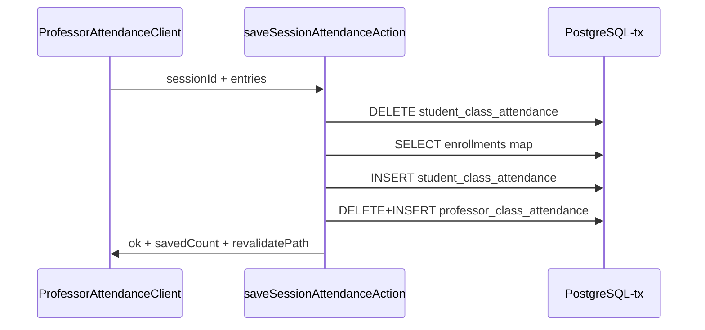
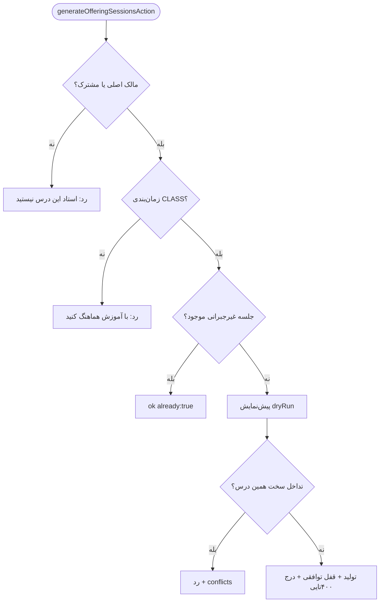
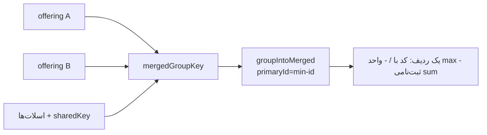
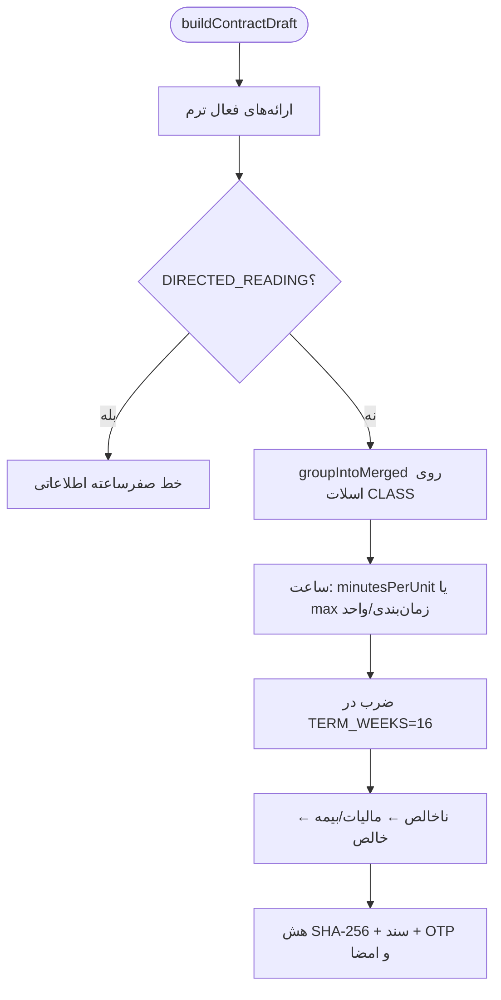

# بخش ۳ — پورتال استاد (`src/app/professor/**`)

> دامنه: Next.js 16 App Router + Drizzle + PostgreSQL، رابط فارسی راست‌به‌چپ. همه صفحات `dynamic = 'force-dynamic'` دارند. مرجع‌ها `فایل:خط` نسبت به ریشه ریپو هستند.

## ۱. پوسته (Shell): `layout.tsx`

- گیت نقش `requireRole(['PROFESSOR'])` در `src/app/professor/layout.tsx:17`؛ ردیف پرسنلی با `getStaffByUser` در `layout.tsx:18`.
- نام واقعی گروه از `departments` با `departmentId` استاد (`layout.tsx:23-27`) و نمایش «نام · کد پرسنلی · گروه» در هدر (`layout.tsx:56`).
- شمار اسناد در انتظار امضا از `electronic_documents` بر اساس `staffId` (`layout.tsx:19-20`) با بج شمارشی در لینک اسناد (`layout.tsx:176-179`).
- ادغام کارتابل استاد و مدیرگروه: `headedDepartments` فقط با نقش `DEP_HEAD` (`layout.tsx:33`) و دکمه «🏛️ پنل مدیر گروه» با نام/تعداد گروه‌ها (`layout.tsx:75-84`).
- حساب دوقلو استاد+دانشجو: لینک سبز «🎓 پنل دانشجو» فقط با نقش `STUDENT` (`layout.tsx:116-124`).
- نشانگر دوکدی: `getSiblingAccounts` (`layout.tsx:36`) و بنر «🔀 کد فعال …» (`layout.tsx:57-64`)؛ `AccountSwitcher` سراسری (`layout.tsx:47`).
- `TermSwitcher` با `variant="dark"` در هدر (`layout.tsx:68-74`) با ورودی `termScope` از `getTermScope(universityId)` (`layout.tsx:42-43`) که فقط با دانشگاه خود استاد اعتبارسنجی می‌شود (`layout.tsx:41-42`).
- ناوبری ۱۰ مقصدی هدر: داشبورد، برنامه، حضور، نمرات، ساعات حضور (هایلایت کهربایی `layout.tsx:143-148`)، عملکرد، ارزشیابی، قرارداد، پیام به کلاس، اسناد (`layout.tsx:108-180`).
- راهنما و PDF در هدر (`layout.tsx:85-97`)؛ قفل بیکاری با `SESSION_LOCK_MINUTES` از تنظیمات (`layout.tsx:39`) و `SessionLock` ته پوسته (`layout.tsx:184`)؛ بدنه `max-w-6xl` (`layout.tsx:183`).

## ۲. صفحه‌ها (route، منبع داده، رفتار ترم، شاخه دمو)

### ۲.۱ داشبورد (`/professor` ← `src/app/professor/page.tsx`)

- بسته اول موازی: ترم‌فیلتر + کلاس زنده + نام گروه + لوگوی دانشگاه (`page.tsx:52-61`)؛ بسته دوم: زمان‌بندی، قرارداد ترمی، شمار بازه‌های حضور، فیش‌ها، اسناد ترم (`page.tsx:67-93`).
- قرارداد فقط با `staffId + termId` از `professor_term_contracts` (`page.tsx:69-74`)؛ شمار حضور از `professor_availabilities` با `count()` (`page.tsx:75-78`)؛ فیش‌ها از جوین `payroll_statements` (`page.tsx:79-85`).
- اگر `term` تهی باشد `professorScheduleRows` صدا زده نمی‌شود (`page.tsx:68`)؛ بنر ترم‌فیلتر همیشه با `selectedTerm` (`page.tsx:169`).
- ادغام نمایشی: `professorUniqueOfferings` (`page.tsx:109`)، نگاشت `mergeSlotsById` (`page.tsx:110-115`)، `offeringSharedKeys` (`page.tsx:116`)، `groupIntoMerged` (`page.tsx:117-121`)؛ کارت ادغامی با `mergedDisplayTitle`، ثبت‌نامی `sum` و ظرفیت/واحد `max` (`page.tsx:140-159`).
- شاخه دمو با `isDemoProfessorUser` (`page.tsx:47`)؛ داده نمایشی از `demo-professor-data` (`page.tsx:3-12`) شامل کارت‌های `DEMO_DASHBOARD_CLASSES` (`page.tsx:123-139`) و قرارداد `DEMO_DASHBOARD_CONTRACT` (`page.tsx:412-449`)؛ جدول هفتگی در دمو رندر نمی‌شود (`page.tsx:332`).
- خالی صادقانه: «در نیمسال … کلاسی ثبت نشده است» (`page.tsx:360-367`) و «قرارداد حق‌التدریسی ثبت نشده است» (`page.tsx:480-486`).
- عملیات سریع هر کارت: `attendance?offeringId=` (`page.tsx:394`) و `grades?offeringId=` (`page.tsx:397`).

### ۲.۲ برنامه هفتگی (`/professor/schedule` ← `schedule/page.tsx`)

- گیت نقش و پرونده (`schedule/page.tsx:32-33`)؛ ترم مؤثر از `professorTermFilter` (`schedule/page.tsx:45`)؛ شاخه دمو با `DEMO_SCHEDULE_OFFERINGS` (`schedule/page.tsx:47-67`).
- مسیر واقعی: نام گروه و دانشگاه موازی (`schedule/page.tsx:69-72`)؛ لوگو از `universities` با fallback `UNIVERSITY_LOGO` (`schedule/page.tsx:73-76`)؛ ردیف‌ها فقط با `term` موجود (`schedule/page.tsx:78-80`).
- دو سطح ادغام: گروه سطح ارائه برای عنوان/کد/ظرفیت مشترک (`schedule/page.tsx:91-95` + `fullInfoById` در `:96-109`) و گروه سطح ردیف هر اسلات (`schedule/page.tsx:110-114`).
- چند `weekType` در یک گروه → `BOTH` (`schedule/page.tsx:130`)؛ پرچم `merged` از عضویت در گروه کامل (`schedule/page.tsx:131`).
- کلاینت `ProfessorScheduleClient.tsx:54`: فیلتر `ALL/EVEN/ODD` در state (`:56`) با `filterProfessorCalendarByWeek` (`:72`)، چاپ با `window.print` (`:96-98`) و سربرگ A4 landscape (`:102-113`).

### ۲.۳ حضوروغیاب (`/professor/attendance` ← `attendance/page.tsx`)

- مالکیت: `professorId = me.id` یا عضو `offering_professors` via زیرکوئری `sharedOfferingIds` (`attendance/page.tsx:78-93`)؛ فقط ارائه فعال ترم جاری دانشگاه خود استاد (`:88-92`).
- `?offeringId=` خارج‌ترمِ مال استاد الحاق و `linkedNotice` می‌شود (`attendance/page.tsx:96-121`) سپس به `primary` گروه نگاشت (`:206`).
- جلسات از `class_sessions` مرتب با `sessionNo` (`:124-126`)؛ زمان‌بندی غیرامتحانی (`:129-134`)؛ اتاق‌ها = زمان‌بندی‌شده + ۲۰ اتاق دانشگاه (`:135-143`).
- دانشجویان فقط `REGISTERED/PENDING_COUNCIL` (`:147-153`)؛ وضعیت‌ها از `student_class_attendance` با کلید `enrollmentId`→`studentId` (`:155-180`)؛ حضور استاد از `professor_class_attendance` (`:183-187`).
- ادغام با `mergedGroupKey` و پیشوند `termId` (`:196-206`)؛ اجتماع دانشجویان بدون تکرار (`:225-233`)؛ حذف جلسات تکراری با کلید تاریخ/ساعت/جبرانی (`:241-245`) و مرتب‌سازی `sessionNo` (`:279`).
- تاریخچه جبرانی واقعی از `isMakeUpSession=1` (`:299-324`)؛ شاخه دمو با `demoAttendanceOfferings`/`demoAttendanceMakeupHistory` (`:50-74`).

### ۲.۴ نمرات (`/professor/grades` ← `grades/page.tsx`)

- بدون ترم جاری توقف کامل با پیام آموزشی (`grades/page.tsx:96-103`)؛ وگرنه مبنا `professorScheduleRows` با یکتاسازی (`:105-108`).
- ادغام با `mergedGroupKey` روی اسلات واقعی (`:110-123`) و نگاشت `defaultOfferingId` به `primary` (`:124-126`).
- دانشجویان فقط `REGISTERED` + اعتراض‌ها (`:127-130`؛ جزئیات `professor-data.ts:200-245`)؛ نگاشت وضعیت به ۴ حالت (`grades/page.tsx:31-37`).
- فراداده دسته‌ای: تقدم `customGradeDeadline` بر مهلت ترم، پرچم `isThesis`، وضعیت `grade_unfinalize_requests` (`grades/page.tsx:149-180`).
- اجتماع ثبت‌نامی اعضای ادغامی بدون تکرار (`:186-192`)؛ نهایی‌بودن با `every(FINALIZED)` (`:242`)؛ درس مشترک با وزن سهمی روی ۲۰ (`:258-272`); دمو با `demoGradesOfferings` (`:87`).

### ۲.۵ اعلام ساعات حضور (`/professor/availability`)

- ترم‌ها از `termsFor(uniId)` (`availability/page.tsx:35`) و ترم مؤثر از `professorTermFilter` (`:36`)؛ سقف واحد از `baseDutyUnits` قرارداد (`:67-73`).
- اکشن خواندن `loadAvailabilityAction` (`availability/actions.ts:26`) و ذخیره `saveAvailabilityAction` (`:58`)؛ دمو با `DEMO_AVAILABILITY_TERM` و سقف ۱۲ (`availability/page.tsx:38-62`).

### ۲.۶ عملکرد (`/professor/performance`)

- زنده از `getProfessorPerformance(me.id)` بدون عدد ثابت (`performance/page.tsx:54`) با مقایسه «میانگین واقعی همکاران» (`:39-44`).
- KPIها: MTTR، پایبندی SLA، مختومه ماه، CSAT (`:98-119`)؛ کارت‌های تدریس/جلسات/نمرات (`:122-154`)؛ نوار من/همکاران (`:157-172`) و مشوق بهره‌وری تنظیماتی (`:175-198`).

### ۲.۷ ارزشیابی (`/professor/evaluation`)

- زنده از `professorPanel(me.id)` موتور BI (`evaluation/page.tsx:70`)؛ ترم دانشگاه از `currentTermFor` (`:58`) با بنر ناهمگامی ترم (`:82-87`).
- خالی صادقانه سه‌سطحی: کل پنل (`:89-98`)، روند (`:145-146`)، ابر کلمات (`:170-171`)؛ رادار SVG من/گروه (`:8-47`).

### ۲.۸ قرارداد (`/professor/contract`)

- ساخت/بازنویسی با `ensureContractDocument` (`contract/page.tsx:61`)؛ بدون ترم پیام آموزشی (`:52-59`) و بدون درس پیام «جدول مصوب خالی» (`:73-89`).
- هش/ساعت امضا از `electronic_documents` در `ContractView` (`:91-106`)؛ دمو با `demoContractView` (`:34-50`).

### ۲.۹ اسناد (`/professor/documents`)

- فهرست محدود به `staffId + termId` مرتب نزولی (`documents/page.tsx:22-33`)؛ برچسب نوع (`:11-15`) و بج امضا (`:55-57`)؛ خالی ترم‌محور (`:39-45`).
- امضا با OTP شش‌رقمی HMAC نمک‌دار و مقایسه زمان‌ثابت (`documents/actions.ts:30-38`)، سقف ۳ صدور در ۱۵ دقیقه (`:59`) و قفل ۵ تلاش (`:12-13`).
- فرعی خارج دامنه: `broadcast/` (پیام به کلاس، `layout.tsx:167-173`) و `lesson-plan/` (ویراستار طرح درس).

### ۲.۱۰ جدول مسیرها (همه `force-dynamic`)

| مسیر | فایل صفحه | نکته ترم/دمو |
|---|---|---|
| `/professor` | `page.tsx` | بدون ترم → ردیف خالی (`:68`)؛ دمو داده نمایشی (`:47`) |
| `/professor/schedule` | `schedule/page.tsx` | دمو بازگشت زودهنگام (`:47-67`) |
| `/professor/attendance` | `attendance/page.tsx` + `ProfessorAttendanceClient.tsx` | `?offeringId=` با `linkedNotice` (`:96-121`) |
| `/professor/grades` | `grades/page.tsx` + `ProfessorGradesClient.tsx` | بدون ترم توقف کامل (`:96-103`) |
| `/professor/availability` | `availability/page.tsx` + `ProfessorAvailabilityClient.tsx` | سقف از قرارداد (`:67-73`) |
| `/professor/performance` | `performance/page.tsx` | بدون شاخه دمو؛ خطا به‌صورت پیام (`:56`) |
| `/professor/evaluation` | `evaluation/page.tsx` | بنر ناهمگامی ترم (`:82-87`) |
| `/professor/contract` | `contract/page.tsx` + `ProfessorContractClient.tsx` | سند PENDING بازنویسی می‌شود |
| `/professor/documents` | `documents/page.tsx` + `documents/[id]/page.tsx` | فیلتر `staffId + termId` (`:22-33`) |
| `/professor/broadcast` | `broadcast/page.tsx` + `ProfBroadcastClient.tsx` | پیام به دانشجویان کلاس‌های خود استاد |
| `/professor/lesson-plan/[offeringId]` | `lesson-plan/[offeringId]/page.tsx` + `LessonPlanEditor.tsx` | ویراستار طرح درس هر ارائه |

### ۲.۱۱ جزئیات تعاملی کلاینت‌ها (تکمیلی)

- کلاینت حضور وضعیت جلسه را از `isHeld`/حضور استاد می‌سازد: `VERIFIED_PRESENT` در برابر `UPCOMING` (`attendance/page.tsx:267-276`) و شمار حاضر/غایب/موجه روی جلسه جاری (`ProfessorAttendanceClient.tsx:803-809`).
- فرم جبرانی از کلاینت با `scheduleMakeupSessionAction` صدا زده می‌شود (`ProfessorAttendanceClient.tsx:678`) و تاریخچه جبرانی پس از ثبت به‌روز می‌شود.
- تولید جلسات از کلاینت با `generateOfferingSessionsAction(currentOffering.id)` (`ProfessorAttendanceClient.tsx:370`) و دکمه آن به `canGenerate` (وجود `CLASS` با روز غیرتهی) گیت می‌شود (`attendance/page.tsx:290`).
- کلاینت نمرات فقط «تب‌ها و توزیع‌کننده داده» است و منطق انتقال وضعیت در `gradesReducer.ts` و `grades-core.ts` قرار دارد (`ProfessorGradesClient.tsx:7-15`).
- سازوکار «مشاهده اعتراض از جدول» با انتقال به تب اعتراضات (`ProfessorGradesClient.tsx:70`) و مودال OTP نهایی در `RosterTab` مدیریت می‌شود (`RosterTab.tsx:49`).
- درخواست بازگشایی نهایی‌شده از `RosterTab` با دلیل متنی حداقل ۱۰ نویسه (`RosterTab.tsx:349` + `actions.ts:608-609`).
- صورت‌جلسه `CertificateTab` نام استاد، دانشگاه و لوگو را برای چاپ می‌گیرد (`CertificateTab.tsx:11-20`) و داده دانشگاه از `universityTitle` + `UNIVERSITY_LOGO` می‌آید (`grades/page.tsx:277-281`).
- اکشن قرارداد `getContractAction` ترم دانشگاه خود استاد را via `currentTermFor` می‌گیرد (`contract/actions.ts:34-36` + `:39-58`)؛ صدور OTP (`:60-75`) و امضا با IP/UserAgent (`:77-113`).
- صفحه جزئیات سند `documents/[id]/page.tsx` سند تکی استاد را با گیت مالکیت نمایش می‌دهد و امضا از همان `documents/actions.ts` انجام می‌شود.
- `broadcast/actions.ts` ارسال پیام به دانشجویان کلاس‌های خود استاد است و `ProfBroadcastClient.tsx` فرم ارسال را رندر می‌کند (title لینک در `layout.tsx:167-173`).
- `lesson-plan/actions.ts` ذخیره طرح درس هر ارائه و `LessonPlanEditor.tsx` ویراستار سمت کاربر است؛ route پارامتری `[offeringId]` دارد.

## ۳. لایه داده مرکزی

- `professorScheduleRows(staffId, termId, universityId)` جوین ارائه+درس+زمان‌بندی+کلاس (`professor-data.ts:63`) با مالکیت `professorId = staffId OR IN (offering_professors)` (`:45-55`)، محدود به ترم/دانشگاه بدون شناسه ثابت (`:57-62`) و حذف تکرار `offeringId:scheduleId` (`:93-96`).
- نگاشت نوع درس از `courseNature` (`professor-data.ts:26-33`) و `weekType` از `scheduleType` (`:35-40`).
- `coTaughtPartners`: فقط ارائه‌های ≥۲ همکار با بیشترین `sharePercentage` (`professor-data.ts:138` + `:163-174`).
- `professorUniqueOfferings`: یکتاسازی بر `id` مستقل از ردیف زمان‌بندی (`professor-week-grid.ts:100-108`).
- `mergedGroupKey`: اولویت `K:<sharedKey>` وگرنه `S:<day|start|end|room>` مرتب (`professor-calendar-layout.ts:61-78`) با `normMergeTime` (`:55-59`).
- `groupIntoMerged`: گروه‌بندی `Map`، کلید `null` = بدون ادغام، `primaryId` = کوچک‌ترین `id` (`professor-calendar-layout.ts:88-119`).
- `collapseMergedOfferings`: کدها با `/`، واحد `max`، ثبت‌نامی `sum`، ثبت `mergedMemberIds` (`professor-data.ts:329-351`).
- شبکه ۵ بازه ثابت (`professor-week-grid.ts:12-18`)؛ `professorRangeMatch` با هم‌پوشانی نه احاطه + پرچم `outsideStandardSlots` ضد حذف بی‌صدا (`:43-56`)؛ `hasProfessorSchedule` اعتبارسنجی روز ۰..۶ (`:65-72`).
- تقویم: محدوده ۰۸:۰۰–۲۰:۰۰ (`calendar-layout.ts:1-2`)، ۷ ستون روز و کف ۳۰ دقیقه (`:3-4`)؛ خوشه‌بندی هم‌پوشانی و ستون‌بندی (`:214-276`) و توزیع هفتگی (`:278-291`).
- `collapseCalendarEntries`: کدها با ` / `، ثبت‌نامی `sum`، ظرفیت/واحد `max`، و `BOTH` هنگام اختلاف `weekType` (`calendar-layout.ts:143-190` + `:168`)؛ نوع هفته `ALL/EVEN/ODD/BOTH` (`:6`).
- `filterProfessorCalendarByWeek`: نگه‌داشتن `ALL` و `BOTH` در فیلتر زوج/فرد (`calendar-layout.ts:39-46`).
- گرید مشترک `professor-calendar-grid.tsx`: ستون‌بندی ۷ روزه RTL با گاتر ساعت (`:127-136`)، خطوط ساعتی/نیم‌ساعتی (`:154-166`)، بج‌های هفته و افسانه (`:43-62` + `:115-123`)، `placeMode='professor'` برای سردر کلاس (`:79-99`)، خروجی چاپ pt (`:196-215`) و CSS چاپ A4 landscape (`week-table.tsx:63`، `ProfessorScheduleClient.tsx:102`).

## ۴. حضوروغیاب و نمرات (جزئیات تعاملی)

- کلاینت حضور سه اکشن (ذخیره، تولید جلسات، جبرانی) را ایمپورت می‌کند (`ProfessorAttendanceClient.tsx:6`)؛ فیلتر فارسی روستر (`:131-150`) و مرتب‌سازی ROW/NAME/CODE/STATUS (`:150-173`)؛ انبوه با `buildBulkStatuses` (`:174`) و دکمه «همه حاضر» (`:1307`) روی جلسه جاری (`:524-534`).
- ذخیره: `saveSessionAttendanceAction(sessionId, entries)` (`attendance/actions.ts:22`) با تراکنش حذف-و-درج همان جلسه و نگاشت `enrollmentId` (`:41-55`) + حضور استاد `MANUAL_ATTENDANCE_SHEET` (`:56-64`) و `revalidatePath` (`:67`).
- جبرانی: `scheduleMakeupSessionAction` (`attendance/actions.ts:75`) درج ردیف واقعی با `isMakeUpSession=1` و وضعیت `SCHEDULED`/`PROPOSED` (`:101-113`) و شماره `max+1` (`:98-99`).
- تولید از UI: `generateOfferingSessionsAction` (`:139`) با مالکیت مستقیم+مشترک (`:155-164`)، الزام `CLASS` (`:166-177`)، کوتاه‌مدار `already:true` (`:179-186`)، پیش‌نمایش `dryRun` و گیت تداخل همین درس (`:188-199`) و تولید تک‌ارائه‌ای (`:201-215`).
- پنج تب نمرات (`ProfessorGradesClient.tsx:178-198`): روستر با `useOptimistic` (`RosterTab.tsx:4`)، بارم (`RubricTab.tsx:4`)، اعتراضات (`AppealsTab.tsx:4`)، تحلیل فقط‌خواندنی (`AnalyticsTab.tsx:4`)، صورت‌جلسه با چاپ بومی (`CertificateTab.tsx:4`).
- بارم پیش‌فرض `DEFAULT_RUBRIC` با جمع ۲۰ (`grades-core.ts:30`)، فیلدها در `SCORE_FIELDS` (`:33`) و سقف با `rubricFieldMax` (`:39`).
- اکشن‌های `grades/actions.ts`: ذخیره تکی با سقف ۰..۲۰ و ایزوله مرجع سرور (`:115-228`)؛ ثبت موقت روی اعضای ادغامی (`:234-284`)؛ OTP نهایی با هش SHA-256 و انقضای ۵ دقیقه (`:291-334`)؛ قفل نهایی با زنجیره هش و کد سما (`:337-436`)؛ اعتراض با بازمحاسبه سروری (`:484-584`)؛ بازگشایی با دلیل ≥۱۰ نویسه (`:590-633`).
- `demo-grades-seed.ts`: `ensureGradePersistence` فقط دمو (`:52`) و `resolveStudentRow` (`:165`)؛ در production داده seed است (`grades/actions.ts:168`).

## ۵. موتور جلسات (`class-session-generator.ts` + `scheduling-core.ts`)

- دو ورودی ترم‌محور (`:141`) و تک‌ارائه‌ای (`:296`)، هر دو تراکنشی با `pg_advisory_xact_lock` روی `termId` (تعریف `:32-34`، فراخوانی `:150` و `:308`).
- مبدأ `classStartDate` با fallback به `startDate` و سقف `classEndDate` (`:154-159`)؛ خواندن فقط `scheduleType='CLASS'` با روز غیرتهی (`:91`).
- گیت `analyzeHardConflicts` پیش از تولید در هر دو مسیر (`:189-195` و `:347-353`) با پرچم `failOnHardConflict` (پیش‌فرض بله، `:38-46`).
- Idempotency افزایشی: فقط «گم‌شده‌ها» کامل، جبرانی دست‌نخورده (`:199-201`)؛ `skipped` از تطابق موجود (`:246-248`).
- درج ۴۰۰تایی (`:265-266` و `:412-413`) با خطای فارسی ایمن (`:268-270`)؛ `dryRun` بدون درج ولی با ممیزی (`:263-292`)؛ ممیزی `SCHEDULING_SESSIONS_GENERATED` (`:274-281`، `:421-429`).
- `computeSessionDates` (`scheduling-core.ts:826`): روز ۰..۶ شنبه=۰ (`:830` + نگاشت JDN در `:814-816`)، اولین تکرار بعد از مبدأ با گام ۷ روزه و سقف ۴۰ هفته (`:840-864`)، حذف تعطیلات و توقف در `classEndDate` (`:853-860`).
- تکرار `ALL/EVEN/ODD` (`class-session-generator.ts:76`) از ستون `scheduleType` (`:84`، `:106-107`) با منطق `oddFirstWeek=true` (`scheduling-core.ts:844-850`).

## ۶. حقوق و قرارداد (`payroll-engine.ts` + `contract-engine.ts`)

- بارگذاری ترم بدون N+1 در `loadTermPayrollData` (`payroll-engine.ts:231`)؛ نرخ از جدیدترین `teaching_rates` مؤثر (`:338-343`) با غلبه اسنپ‌شات قرارداد (`:366-370`).
- ادغام پیش از محاسبه (`:530-533`، یک ردیف برای ادغامی) با جلسات بیشترین `held` (`pickMergedSessions` در `:510-518`) و برچسب «(کلاس ادغامی)» (`:543`).
- مسیر RULE: `matchRule` خاص‌ترین قاعده (`:188-195`) با سه زیرمسیر `flatFee`/`multiplierPerStudent`/`multiplierUnit` (`:549-560`) شامل `DIRECTED_READING` = «معرفی به استاد» (`:134`).
- مسیر ضرایب: عملی، ارشد (پیشوند کد)، جمعی (`:574-581`) با آستانه `PAYROLL_CROWDED_THRESHOLD` و پیش‌فرض جلسات (`:317-320`) و سهم درصدی همکار؛ واحد مؤثر با غیبت خالص (`:586-587`) و کسر غیبت در deductions و مأخذ مالیات (`:607-610`).
- گلوگاه تسویه: نمرات `FINALIZED` + اسناد `SIGNED` با خواندن سبک تراکنشی (`:476-498`) و الزام `DEAN_APPROVED` با محموله ضد-رقابت (`:915-936`).
- `buildContractDraft` (`contract-engine.ts:68`): فقط ارائه فعال ترم (`:75-79`)؛ جداسازی `DIRECTED_READING` (`:81-82`) با ردیف صفرساعته اطلاعاتی (`:142-153`).
- ادغام روی اسلات `CLASS` (`:103-115`) با یک خط و `mergedDisplayTitle` (`:118-141`)؛ ساعت از `minutesPerUnit` وگرنه `max(زمان‌بندی، واحد)` (`:128-130`)؛ مجموع با `TERM_WEEKS=16` (`:15`، `:139`).
- نرخ/درصدها از تنظیمات (`:57-63`)؛ ناخالص←مالیات/بیمه←خالص (`:155-160`) و نیم/نهایی نصف‌شده (`:192-193`)؛ شماره `CON-<termCode>-<4رقم>` (`:166`).
- `ensureContractDocument`: بازنویسی `PENDING` و مصونیت `SIGNED` (`:227-244`)؛ هش SHA-256 روی JSON متعارف (`:203-221`، اعمال `:237`)؛ OTP با انقضای ۵ دقیقه و قفل ۵ تلاش (`:287-313`) و ثبت IP/UserAgent (`:298-324`).
- جداول: `professor_term_contracts` با اسنپ‌شات مرتبه/پایه/نرخ (`:264-271`) و `electronic_documents` با `TEACHING_CONTRACT` (`:273-281`)؛ اکشن‌های نازک با ترم دانشگاه خود استاد (`contract/actions.ts:34-36`، `:39-113`).

## ۷. نمودارهای Mermaid

### ۷.۱ جریان ذخیره حضوروغیاب

### ۷.۲ جریان تولید جلسات (تک‌ارائه از UI استاد)

### ۷.۳ فروپاشی کلاس ادغامی

### ۷.۴ محاسبه قرارداد

## ۸. موضوعات برش‌عرضی

- ترم مؤثر همه صفحات از `professorTermFilter(universityId)` (`professor-term-filter.ts:14`)؛ بنر مشترک فقط `selectedTerm` وگرنه `null` (`term-filter-banner.tsx:14`) با توضیح دمو (`professor-term-filter.ts:36`).
- دمو: نمرات (`demo-professor-data.ts:216`)، حضور (`:402`)، قرارداد (`:573`)؛ خودترمیمی ردیف‌ها در دمو (`grades/actions.ts:168-182`) و برگرداندن OTP در `isDemoMode` (نمره `:330`، قرارداد `contract-engine.ts:294`).
- خالی صادقانه: جدول هفتگی (`week-table.tsx:26-38`)، قرارداد بدون درس، اسناد، ارزشیابی — بدون عدد نمایشی ثابت.
- چاپ: سربرگ (لوگو، استاد/دانشگاه، تاریخ شمسی) فقط `print:block` (`week-table.tsx:64-74`)؛ بدنه pt گرید (`professor-calendar-grid.tsx:196-215`)؛ هدر و بنر `print:hidden` (`layout.tsx:48`، `term-filter-banner.tsx:17`).
- پرداخت میان‌ترم: درصدی از تنظیمات (`PAYROLL_MIDTERM_PERCENT`) با قفل سطری تراکنشی در `payMidterm` (`payroll-engine.ts:852-887`)؛ تسویه نهایی فقط پس از زنجیره تأیید (`payroll-engine.ts:889-951`).
- خروجی بانکی: `exportBatch` با ۳۰ ستون دیسکت بانکی (`payroll-engine.ts:954-990`)؛ داشبورد مالی `getOverview` فقط اساتید دارای قرارداد (`payroll-engine.ts:750-798`) و فیش استاد `getStaffPayslip` (`:800-825`).
- پول با عدد صحیح ریالی و گردکردن به مضرب ۱۰ ریال؛ بدون خطای اعشار (`payroll-engine.ts:33-34`، توابع `toRial`/`UNIT_SCALE` در `:15`).
- ممیزی زنجیره هش (`writeAudit` با `prevHash`) در محاسبه/پرداخت (`payroll-engine.ts:830-849` + `:735-742`).
- ترم‌فیلتر استاد `ProfessorTermFilter` شامل `term` مؤثر و `selectedTerm` نمایشی است (`professor-term-filter.ts:14`) و همه صفحات `universityId` استاد (با fallback دانشگاه کاربر) را پاس می‌دهند، مثلاً داشبورد (`page.tsx:50`) و حضور (`attendance/page.tsx:47`).
- آمار کلاینت برنامه: واحد/دانشجو/کلاس یکتا، روزهای دارای کلاس و فهرست بدون‌زمان‌بندی (`ProfessorScheduleClient.tsx:61-72`) با برچسب فیلتر هفته فارسی (`:93`).
- جدول هفتگی داشبورد (`week-table.tsx:19`): تفکیک زمان‌بندی‌شده/نشده (`:22-23`)، تاریخ چاپ شمسی (`:24`) و ورودی چاپی `collapseCalendarEntries(scheduled)` (`:40-59`).
- `offeringSharedKeys`: خواندن `sharedScheduleGroupKey` غیرتهی ارائه‌ها (`professor-data.ts:300-312`) که مبنای ادغام قراردادی/تقویمی است، نه حدس نمایشی.
- تشخیص تداخل سخت `analyzeHardConflicts` روی (استاد، اتاق، ظرفیت) ورودی `HardConflictEntry` است (`class-session-generator.ts:173-190`) و `inspectSchedulingHardConflicts` خلاصه سقف‌دار برای UI می‌دهد (`:450-477`).
- خلاصه جلسات ترم `getTermSessionsSummary` با GROUP BY (کل/جبرانی/اولین تاریخ) (`class-session-generator.ts:480-492`) و نام استادان بدون N+1 (`professorNamesForOfferings` در `:495-507`).
- ثبت تغییرات نمره در audit (`logGradeChange` تکی در `grades/actions.ts:203-214` و `logBulkGradeChange` در `:275-277`) و رویداد ایجاد جبرانی در لاگر (`attendance/actions.ts:115`).
- پیامک OTP نمره از سرویس پیکربندی‌شده + کانال پیام‌رسان استاد (سروش/بله/ایتا/تلگرام) (`grades/actions.ts:322-327`)؛ کد خام فقط در دمو برمی‌گردد (`:330`).
- ایزوله درس مشترک در نمره از مرجع سرور (`serverCoTeach` روی `offering_professors.role` در `grades/actions.ts:97-109`) و ادعای کلاینت فقط می‌تواند محدودتر کند (`:154-166`).
- قفل نهایی نمره در سه نقطه اعمال می‌شود: ذخیره تکی (`:130-137`)، ثبت موقت (`:246-254`) و پذیرش اعتراض روی `FINALIZED` (`:521-525`)؛ بازگشایی فقط با درخواست دومرحله‌ای مدیر (`:590-633`).
- درس مشترک ≥۲ ردیف `offering_professors` است (همان قاعده `coTaughtPartners`) و نقش از `PRACTICAL/LAB` به عملی نگاشت می‌شود (`grades/actions.ts:92-109` + `professor-data.ts:119`).
- برچسب زمان‌بندی نمایشی حضور از `formatScheduleLabel` (`professor-attendance-display.ts`) و ادغام رفرش کلاینت با `mergeRefreshedOfferings` (`ProfessorAttendanceClient.tsx:7`).
- تایپ‌های مشترک نمرات (`StudentGradeItem`/`GradeAppealItem`/`StudentGradeField`) در `grades/types.ts` و کاهش‌دهنده وضعیت در `gradesReducer.ts` تعریف شده‌اند (مصرف در `ProfessorGradesClient.tsx`).
- عملکرد از `getProfessorPerformance` (`lib/professor-performance.ts`) و ارزشیابی از `professorPanel` موتور BI (`lib/bi-engine.ts`) تغذیه می‌شوند؛ ابر کلمات داخل PostgreSQL استخراج و کش می‌شود (`evaluation/page.tsx:166-169`).
- آستانه بحرانی ارزشیابی (`panel.threshold`) و پرچم `flagged` زیر آستانه با پیام پشتیبانی کیفیت تدریس (`evaluation/page.tsx:108-123`).
- رتبه ارزشیابی «مقام X از Y» میان اساتید دارای کلاس و رتبه سرعت پاسخگویی پرونده‌ها در سربرگ عملکرد (`performance/page.tsx:84-94`).
- مهلت نهایی‌سازی نمرات داشبورد از `term.gradeEntryDeadline` با قالب شمسی (`page.tsx:99` + `:251-260`) و وضعیت امضا سه‌حالته `SIGNED/PENDING/NONE` از اسناد ترم (`page.tsx:101-105`).
- ویجت کلاس مجازی `VirtualClassroomWidget` با نشست‌های امروز (`getTodayLiveClasses` در `page.tsx:54`) و بنر آنبورد پیام‌رسان (`MessengerOnboardBanner` در `page.tsx:170`) در داشبورد قرار دارند.
- «تأییدنشده»: پوشش کامل `week-table.tsx:80-126` (فقط ۸۰ خط اول بازبینی شد) و ادامه `ProfessorScheduleClient.tsx:121-406`.
- «تأییدنشده»: صحت فرمول پیامک/هش OTP اسناد در محیط production (کد خوانده شد ولی ارسال واقعی پیامک راستی‌آزمایی نشد).
- «تأییدنشده»: رفتار `TermSwitcher` هنگام چند دانشگاهی بودن کاربر (فقط مسیر تک‌دانشگاهی استاد بررسی شد).
- «تأییدنشده»: متن/وضعیت پیامک واقعی OTP قرارداد در production ردیابی نشد.
- «تأییدنشده»: مقادیر پیش‌فرض محیطی ضرایب/آستانه‌های حقوق راستی‌آزمایی نشد.
- «تأییدنشده»: جزئیات درونی `ProfessorAvailabilityClient` و `ProfessorContractClient` (فقط ورودی/خروجی مستند شد).
