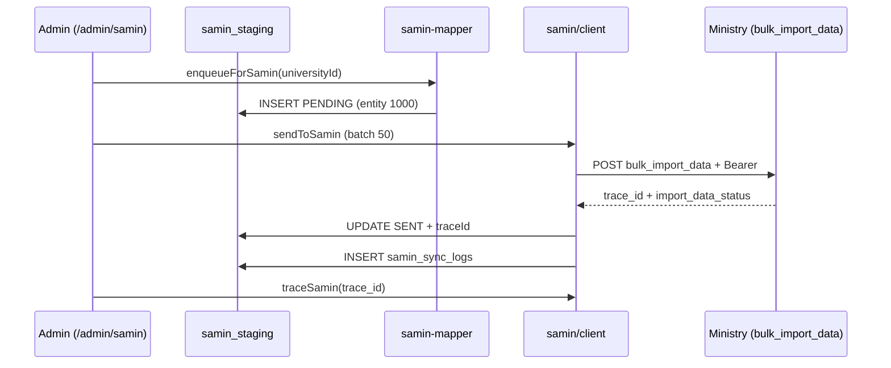
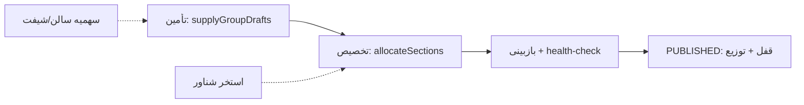

# بخش ۴ — ناحیهٔ مدیریت (Admin) + موتورهای مشترک + یکپارچه‌سازی‌ها

> دامنه: `src/app/admin/**` + `src/lib/*engine*.ts` و موتورهای مشترک + `src/lib/samin/*` + `src/app/help/**`. قرارداد راست‌به‌چپ فارسی در کل شاخهٔ ادمین. این سند فقط توصیف وضع موجود است.

---

## ۱) پوستهٔ مدیریت (Admin Shell)

### ۱-۱. گارد شاخه (`src/app/admin/layout.tsx`)

- کامپوننت `AdminLayout` در `src/app/admin/layout.tsx:13` تعریف شده و `requireRole([...AREA_ROLES, ...LIMITED_ROLES])` را در خط `src/app/admin/layout.tsx:34` صدا می‌زند.
- فهرست `AREA_ROLES` در `src/app/admin/layout.tsx:15-25` شامل `ADMIN, EDU_EXPERT, ARCHIVE_EXPERT, FINANCE_EXPERT, FINANCE, MILITARY_OFFICER, VAULT_MANAGER, DEP_HEAD, VICE_EDU` است.
- استثنای محدود `LIMITED_ROLES = ['PROFESSOR','GRADUATION_EXPERT']` در `src/app/admin/layout.tsx:32` برای میز دفاع تعریف شده؛ توضیح محدودیت App Router (ناتوانی layout در دیدن زیرمسیر) در `src/app/admin/layout.tsx:26-31` کامنت شده است.
- نقش‌های سفارشی دارای مجوز واقعی از مسیر `requireRoleOrPermission([], ['*'])` در `src/app/admin/layout.tsx:38-41` عبور می‌کنند؛ کدهای مجوز کاربر با `getUserPermissionCodes(user.id)` در `src/app/admin/layout.tsx:43-44` برای منوی RBAC بارگذاری می‌شود.
- یادداشت صریح دربارهٔ نبود گارد در `regulation-check` و نبود گارد در کنش `setUniversityCookie` در `src/app/admin/layout.tsx:29` و `src/app/admin/layout.tsx:45-46` آمده است.
- تم دانشگاه با `uniTheme(curUni.code)` در `src/app/admin/layout.tsx:50` و قفل بیکاری با `getNumber('SESSION_LOCK_MINUTES', 15)` در `src/app/admin/layout.tsx:53` خوانده می‌شود؛ `SessionLock` در `src/app/admin/layout.tsx:108` رندر می‌شود.

### ۱-۲. جای‌گذاری سوییچرها (`src/app/admin/layout.tsx:70-83`)

- `TermSwitcher` با `terms/selectedId/effectiveId/universityId` در `src/app/admin/layout.tsx:71-76` رندر می‌شود (داده از `getTermScope(curUni.id)` در خط ۵۱).
- `UniversitySwitcher` فقط وقتی `canSwitchUniversity` برقرار باشد در `src/app/admin/layout.tsx:77-83` نمایش داده می‌شود؛ شرط آن در `src/app/admin/layout.tsx:47` تعریف شده (فقط `AREA_ROLES`، نه دو نقش محدود).
- لینک راهنما `/help/admin` در `src/app/admin/layout.tsx:84-89` و دانلود `/help/pdfs/admin.pdf` در `src/app/admin/layout.tsx:90-96` در هدر است؛ `ThemeToggle` و فرم `logoutAction` در خطوط ۹۷-۱۰۲.
- بدنه در `src/app/admin/layout.tsx:107` (`max-w-6xl`) و `AdminNav` در `src/app/admin/layout.tsx:105` با `roles/permissions/theme` تزریق می‌شود.

### ۱-۳. `AdminNav` (`src/app/admin/AdminNav.tsx`)

- کشوی ثابت بالا-راست با دکمهٔ `☰ منو` در `src/app/admin/AdminNav.tsx:49-56`؛ پنل لغزنده راست (`w-80`) در `src/app/admin/AdminNav.tsx:63`.
- بستن با تغییر مسیر (`src/app/admin/AdminNav.tsx:28`) و کلید Escape (`src/app/admin/AdminNav.tsx:30-35`)؛ جست‌وجوی ماژول با `normalizeFa/faIncludes` در `src/app/admin/AdminNav.tsx:40-44` و ورودی جست‌وجو در خطوط ۷۵-۸۱.
- ماژول‌ها از `navModules(roles, permissions)` در خط ۳۷ و `groupedModules` در خط ۳۸ (`src/lib/admin-modules.ts:586-604`) می‌آیند؛ حالت خالی «ماژولی یافت نشد.» در `src/app/admin/AdminNav.tsx:131-133`.
- تم پیش‌فرض ایندیگو در `src/app/admin/AdminNav.tsx:15-22`؛ لینک ثابت راهنما در `src/app/admin/AdminNav.tsx:136-142`.

### ۱-۴. `UniversitySwitcher` (`src/app/admin/UniversitySwitcher.tsx`)

- اگر کمتر از ۲ دانشگاه باشد `null` برمی‌گرداند (`src/app/admin/UniversitySwitcher.tsx:34`)؛ انتخاب فعلی با `find(u.code===currentCode)` در خط ۳۵.
- تغییر دانشگاه با `setUniversityCookie(code)` (ایمپورت در خط ۵) و سپس `window.location.href` با حذف `university` و ریست `page` در خطوط ۴۳-۵۱ انجام می‌شود؛ نقطه‌کد `(منحله)` برای `kind==='DISSOLVED'` در خطوط ۶۹ و ۸۷.
- رجیستری مرکزی ماژول‌ها `ADMIN_MODULES` در `src/lib/admin-modules.ts:51-568` است؛ `canSeeModule` (عبور همیشگی ADMIN) در خطوط ۵۷۱-۵۸۳.

---

## ۲) ناحیه‌های مدیریتی (Admin Areas)

> گارد هر صفحه مستقل است؛ نقش‌های زیر از `requireRole` همان صفحه و `roles` رجیستری (`src/lib/admin-modules.ts`) نقل شده‌اند.

### ۲-۱. `students` — پروندهٔ جامع (بزرگ‌ترین صفحه)

- صفحه در `src/app/admin/students/page.tsx:9` کلاینت `StudentsManagerClient` را سوار می‌کند؛ گارد صفحه `requireRoleOrPermission` در `src/app/admin/students/page.tsx:20-21` است.
- ایمپورت اکشن‌ها در `src/app/admin/students/StudentsManagerClient.tsx:6` شامل `updateStaffProfileAction, updateStudentProfileAction, saveUserRolesAction, resetUserPasswordAction, bulkResetPasswordsAction, bulkResetToNationalCodeAction, bulkForcePasswordChangeAction, createStaffExpertAction, getTranscript, setStudentRegulationAction, setUserActiveAction` است.
- ویرایش پروفایل پرسنل در `src/app/admin/students/StudentsManagerClient.tsx:221` (`updateStaffProfileAction(currentStaff.id, patch)`)؛ تعریف اکشن در `src/app/admin/students/actions.ts:1014` با گارد `requireRole(['ADMIN'])` در خط ۱۰۱۸.
- گاردهای خواندن پرونده در `src/app/admin/students/actions.ts:22` (`ADMIN, EDU_EXPERT, ARCHIVE_EXPERT, MILITARY_OFFICER, GRADUATEAFFAIRS`) و چند اکشن مدیریتی ADMIN-only در خطوط ۴۲۶، ۴۷۹، ۵۰۶، ۵۶۴، ۶۲۰، ۶۶۰، ۶۹۲، ۷۴۶، ۸۸۹ تکرار شده‌اند.
- چاپ کارنامه با `window.print()` در `src/app/admin/students/StudentsManagerClient.tsx:78`؛ ناحیهٔ ابزار با `print:hidden` در خطوط ۱۳۱۹ و ۱۴۰۳؛ پیام خالی «کارنامه‌ای برای این دانشجو یافت نشد…» در خط ۱۴۴۸.
- مودال‌ها با `print:hidden` در خطوط ۲۱۵۲، ۲۳۱۶، ۲۴۱۱، ۲۴۸۹، ۲۵۳۸، ۲۶۱۲ مخفی‌چاپ می‌شوند. جزئیات تب‌ها (دانشجو/استاد)، مرتب‌سازی و صفحه‌بندی «تأییدنشده» است (فایل ۲۶۰۰+ خطی به‌طور کامل بازخوانی نشده).

### ۲-۲. `staff`

- جدول در `src/app/admin/staff/StaffTable.tsx:250` حالت خالی «موردی یافت نشد.» دارد. گارد و اکشن‌های ایجاد/ویرایش «تأییدنشده» (نیازمند بازخوانی `src/app/admin/staff/page.tsx` و `actions.ts`).

### ۲-۳. `curriculum` — کاتالوگ و سرفصل

- کامنت قانون طلایی «هیچ دادهٔ Mock نیست» در `src/app/admin/curriculum/CurriculumManagerClient.tsx:12`؛ همه‌چیز از Server Actions می‌آید.
- هدر رشته با پیام «— موردی با این فیلتر یافت نشد —» در `src/app/admin/curriculum/components/CurriculumHeader.tsx:86`. تفکیک versions/tracks/courses «تأییدنشده» در این بازخوانی.

### ۲-۴. `terms` — ترم‌ها (فعال‌سازی گروهی + همگام‌سازی تاریخ)

- گارد `requireRole(['ADMIN'])` در `src/app/admin/terms/page.tsx:11`.
- اکشن تکی `activateTermAction` در `src/app/admin/terms/actions.ts:64-65`؛ گروهی `bulkActivateTermsAction` در خطوط ۱۱۳-۱۱۶ (لاگ خطا در خط ۱۷۰)؛ همگام‌سازی تاریخ `syncTermsWithDateAction` در خطوط ۱۷۵-۱۷۶.
- کلاینت دکمهٔ «فعال‌سازی گروهی (N دانشگاه)» در `src/app/admin/terms/TermsClient.tsx:253-269` و وضعیت `busy: 'single'|'bulk'|'sync'` در خط ۶۴ را دارد.

### ۲-۵. `samin` — صف ارسال دستی (جزئیات کامل در §۳)

- صفحه `ADMIN`-only در `src/app/admin/samin/page.tsx:11`؛ پیام خالی هوشمند «صف دانشگاه … خالی است» در خطوط ۵۲-۶۵. اکشن‌های `enqueueForSamin/sendToSamin/traceSamin` — رجوع به §۳.

### ۲-۶. `scheduling` — فضای کاری برنامه‌ریزی

- رجیستری: `href: '/admin/scheduling'` با نقش‌های `EDU` در `src/lib/admin-modules.ts:161-171`. موتور در §۴ مستند است. نام دقیق اکشن تولید («generation action») «تأییدنشده».

### ۲-۷. `offerings` — هدف‌گیری + نوع ارائه

- گزینه‌ها `['NORMAL','SUMMER','DIRECTED_READING']` در `src/app/admin/offerings/page.tsx:60`؛ برچسب فارسی `DIRECTED_READING: 'معرفی به استاد'` در `src/app/admin/offerings/OfferingsClient.tsx:5`.
- منطق رؤیت در `src/lib/offering-targeting.ts:17-23` (`offeringVisible`) و برچسب در خطوط ۲۵-۳۲؛ `NULL` یعنی بدون محدودیت (خط ۲).

### ۲-۸. `finance` / `payroll` — مالی و حقوق

- رجیستری مالی: `/admin/finance` در `src/lib/admin-modules.ts:323-334`، `/admin/student-finance` در خطوط ۳۱۰-۳۲۱، `/admin/tuition` در خطوط ۳۳۶-۳۴۷، POS در خطوط ۳۴۹-۳۶۰ — همه با مجوز `finance:view_ledger`.
- جدول مالی حالت خالی «دانشجویی با این فیلترها یافت نشد.» در `src/app/admin/finance/FinanceTable.tsx:117`؛ ستون چاپ‌مخفی در خطوط ۸۰، ۱۰۶، ۱۳۱.
- حقوق: رجیستری `/admin/payroll` در `src/lib/admin-modules.ts:297-308`؛ پیام خالی «ردیفی یافت نشد. ابتدا محاسبهٔ فیش ترم را بزنید.» در `src/app/admin/payroll/LivePayrollClient.tsx:325`؛ تب‌های ضرایب/قوانین با پیام «هیچ ضریبی/قانونی یافت نشد» در `src/app/admin/payroll/components/CoefficientsRulesTab.tsx:275` و `:439` (تکرار در `LivePayrollClient.tsx:705,869`).
- انواع `OFFERING_TYPES` شامل `DIRECTED_READING` در `src/app/admin/payroll/LivePayrollClient.tsx:646` و `CoefficientsRulesTab.tsx:43`؛ نگاشت فارسی `DIRECTED_READING: 'معرفی به استاد'` در `src/lib/payroll-engine.ts:134`.
- چاپ فیش با `window.print()` در `src/app/admin/payroll/PayrollEngineClient.tsx:467,694` و کانتینرهای `print:hidden` در خطوط ۳۷۷، ۴۵۹، ۴۸۴، ۶۸۵.

### ۲-۹. `reports`

- جست‌وجوی گزارش با پیام «گزارشی با این عبارت … یافت نشد.» در `src/app/admin/reports/ReportsClient.tsx:237` و «رکوردی با این فیلترها یافت نشد.» در خط ۳۷۸. برش شناسه‌ها به ۵۰۰ در `src/app/admin/reports/r-staff.ts:148` و `r-class.ts:240,269`.

### ۲-۱۰. `settings` / `universities` / `permissions` / `migration`

- `settings` در رجیستری `src/lib/admin-modules.ts:557-567` (ADMIN-only)؛ sanitize رویدادهای OTP در `src/app/admin/settings/backup-actions.ts:16` و یادداشت «دامپ sanitize شده (ردکشن رازها)» در خط ۱۲۸.
- `universities` در `src/lib/admin-modules.ts:485-495` (ADMIN-only، «آفاق + منحل‌شده‌ها»).
- `permissions` (ماتریس RBAC) در `src/lib/admin-modules.ts:448-458` (ADMIN-only).
- `migration` (ETL) در `src/lib/admin-modules.ts:497-507`؛ انواع بچ `codes|tuition-formula|legacy-financial|grades` در `src/lib/migration/batches.ts:22`؛ تب نمرات با نگاشت خطا در `src/app/admin/migration/GradesTab.tsx:14`. جزئیات ویزارد «تأییدنشده».

### ۲-۱۱. `exams` / `grade-status-codes` / `short-courses` / `regulations` / `tuition`

- `exams`: رجیستری `src/lib/admin-modules.ts:172-183` (`ADMIN, EDU_EXPERT, VAULT_MANAGER`)؛ کامنت «هیچ دادهٔ Mock نیست» در `src/app/admin/exams/ExamPlanningClient.tsx:6`.
- `grade-status-codes`: رجیستری در `src/lib/admin-modules.ts:124-135`؛ سه پیام «درسی یافت نشد.» در `src/app/admin/grade-status-codes/GradeCodesClient.tsx:378,463,624`.
- `short-courses`: رجیستری در `src/lib/admin-modules.ts:374-384`؛ صدور گواهی با `pg_advisory_xact_lock` و `short_term_certificate_seq` در `src/lib/verification.ts:448-456`.
- `regulations`: رجیستری در `src/lib/admin-modules.ts:137-147`؛ هشدار «سیاست ۱۳۹۱ … حد نصاب خالی است» در `src/app/admin/regulations/RegulationsClient.tsx:1125`.
- `tuition`: موتور بدون نرخ سخت‌کد در `src/lib/tuition-engine.ts:9-23`؛ سلسله‌مراتب `مقطع > رشته > نوع ترم > نوع گذراندن > بازهٔ ورودی` در خطوط ۱۳-۱۷؛ `loadActiveFeeRules` در خط ۳۸ و `resolveFeeRule` در خط ۴۳.

### ۲-۱۲. `workflows` / `graduation` / `defense-scheduling` / `departments`

- `workflows`: رجیستری در `src/lib/admin-modules.ts:386-396`؛ موتور تراکنشی با `for update` و idempotent پایانه‌ها در `src/lib/workflow-engine.ts:28-39`؛ وضعیت‌های پایانی در خط ۵۴ و باز در خط ۵۷.
- `graduation`: رجیستری ADMIN + مجوز `graduation:review_dossier` در `src/lib/admin-modules.ts:460-471`؛ مسیر وضعیت‌ها در `src/lib/graduation-engine.ts:29-33` و گام‌ها در خطوط ۳۷-۴۶.
- `defense-scheduling`: رجیستری با `ADMIN, EDU_EXPERT, GRADUATION_EXPERT, DEP_HEAD, PROFESSOR` در `src/lib/admin-modules.ts:473-483`.
- `departments`: رجیستری `ADMIN, VICE_EDU` در `src/lib/admin-modules.ts:100-111`؛ پیام «گروهی یافت نشد.» در `src/app/admin/departments/DepartmentsClient.tsx:232` و «ردیفی یافت نشد.» در `OrphanCoursesPanel.tsx:196`.

### ۲-۱۳. `archive` / `bi` / `admissions` / `codes` / `templates`

- `archive`: رجیستری `ADMIN, ARCHIVE_EXPERT` در `src/lib/admin-modules.ts:285-295`.
- `bi`: رجیستری ADMIN-only در `src/lib/admin-modules.ts:436-446`؛ کامنت «هیچ دادهٔ نمونه‌ای نیست» در `src/app/admin/bi/page.tsx:34`؛ موتور با CTE و `regexp_split_to_table` و کش `analytics_snapshots` در `src/lib/bi-engine.ts:10-35`.
- `admissions`: رجیستری `EDU` در `src/lib/admin-modules.ts:76-87`؛ توابع `parseAndStageSanjeshData` / `importStagedToStudents` / `registerManualStudent` «تأییدنشده» (نام‌ها از اکتشاف اولیه، خط دقیق بازخوانی نشده).
- `codes`: رجیستری در `src/lib/admin-modules.ts:88-99`؛ کامنت ساخت کد استاندارد از کد ترم در `src/app/admin/codes/CodesClient.tsx:195`.
- `templates` + `broadcast`: رجیستری `EDU` در خطوط ۱۸۴-۲۰۷؛ برش بدنه به ۳۰۰ کاراکتر در `src/app/admin/broadcast/actions.ts:385`.

### ۲-۱۴. `student-cards` / `student-finance` / `id` / `manual`

- `student-cards`: رجیستری `EDU` در `src/lib/admin-modules.ts:362-372`؛ پیام «دانشجویی یافت نشد.» در `src/app/admin/student-cards/StudentCardsClient.tsx:201`؛ صدور/تمدید با توکن ۲۴بایتی در `src/lib/verification.ts:141-165`.
- `student-finance`: صورت‌حساب چاپی با `window.print()` در `src/app/admin/finance/reports/StudentStatementClient.tsx:146` و ناحیهٔ `print:hidden` در خط ۱۵۶.
- مسیر عمومی `id/[token]` (گیت حراست) در `src/lib/verification.ts:17-29` مستند است؛ `verifyStudentCard` تک‌کوئری JOIN در خطوط ۱۷۲-۱۹۷ بدون دادهٔ ساختگی.
- `manual-enroll` در رجیستری `src/lib/admin-modules.ts:208-220` و `group-transfer` در خطوط ۲۲۱-۲۳۳ (هر دو با مجوز `edu:manage_enrollment`)؛ `offering-editor` در خطوط ۲۳۴-۲۴۶ با مجوز `scheduling:manage_chart`.

---

## ۳) یکپارچه‌سازی ثمین (Samin)

### ۳-۱. فایل‌ها و جداول

- کلاینت: `src/lib/samin/client.ts`؛ نگاشت: `src/lib/samin/samin-mapper.ts`؛ رمز: `src/lib/samin/crypto.ts` (نام از فهرست دایرکتوری؛ محتوا بازخوانی نشده — «تأییدنشده»).
- صفحهٔ هاب: `src/app/admin/samin/page.tsx`؛ اکشن‌ها: `src/app/admin/samin/actions.ts`؛ کلاینت UI: `src/app/admin/samin/SaminClient.tsx`.
- جداول مصرفی: `samin_connections, samin_staging, samin_sync_logs, universities` (ایمپورت در `src/lib/samin/client.ts:2-3` و `src/app/admin/samin/page.tsx:2`).

### ۳-۲. احراز هویت و کش توکن

- کش درون‌حافظهٔ ۵دقیقه‌ای `tokenCache` در `src/lib/samin/client.ts:8`؛ بررسی انقضا با حاشیهٔ ۶۰ثانیه در خط ۱۸.
- استفادهٔ مجدد از توکن رمزنگاری‌شدهٔ DB در خطوط ۲۵-۳۲ (`decryptSecret(conn.tokenEnc)`)؛ رمزگشایی `clientSecret/password` در خطوط ۳۴-۳۵.
- گرنت `password` با `Basic(clientId:secret)` در خطوط ۳۷-۵۰؛ خطای توکن با برش ۳۰۰ کاراکتر در خط ۵۴؛ ذخیرهٔ رمزنگاری‌شده با `encryptSecret` در خطوط ۶۳-۶۸.

### ۳-۳. ساخت پیلود (`src/lib/samin/samin-mapper.ts`)

- تابع دانشجو `buildSaminPayloadForStudent` در خط ۴۶ (جوین `students+users` در خطوط ۴۷-۵۳) مطابق سند `V0.6 صفحهٔ ۸-۹` (کامنت خط ۳۳-۳۵).
- تاریخ میلادی → شمسی `YYYY/MM/DD` با `toJalaliDay/jalaliDateOf` در خطوط ۸-۱۷؛ سال ورودی → بازهٔ `1398-1399` با `toEduYear` در خطوط ۲۰-۲۴؛ ملیت پیش‌فرض `120001` در خطوط ۲۷-۳۱.
- حل جغرافیا با `resolveCityMinistry(ByCode)` در خطوط ۵۸-۶۴؛ کد مقطع از `degree_level_configs.standardCode` در خطوط ۷۱-۸۱؛ کد ثمین دانشگاه از `universities.saminCode` در خطوط ۸۲-۹۳.
- نگاشت‌ها: `mapGraduateState` (`ACTIVE:0, GRADUATED:1, EXPELLED:2, SUSPENDED:3`) در خطوط ۱۶۸-۱۷۱ و `mapGender` در خطوط ۱۷۲-۱۷۶.
- پیلود فرد (entity `2001`) با `buildSaminPersonPayloadForStudent` در خط ۱۸۲ (کامنت «قبل از دانشجو (1000)» در خط ۱۸۰).

### ۳-۴. نقاط پایانی bulk و رهگیری

- `saminBulkImport` در `src/lib/samin/client.ts:74` به `POST /api/mdm/import_data/bulk_import_data/` (خط ۷۸) با بدنهٔ `{importdata:{data, entity_code, import_type_code}}` (خط ۸۶)؛ لاگ محلی در `samin_sync_logs` در خطوط ۹۳-۱۰۰.
- `saminTrace` در خط ۱۰۵ به `GET .../trace_bulk_import_data?trace_id=` (خط ۱۰۹)؛ `saminGetChangesLog` در خط ۱۱۷ به `.../log/get_changeslog` (خط ۱۲۳).
- `enqueueSaminPayload` در خط ۱۳۱ با `onConflictDoNothing` (خط ۱۳۸).

### ۳-۵. صف دستی ادمین (staging + send)

- شمارش صف per-university با `groupBy` در `src/app/admin/samin/page.tsx:19-22`؛ ۵۰ ردیف staging در خط ۲۴ و ۲۰ لاگ در خط ۲۵؛ تب per-دانشگاه با شمار فارسی در خطوط ۳۸-۵۱.
- `enqueueForSamin(universityId)` در `src/app/admin/samin/actions.ts:11` (حد ۵۰۰۰ دانشجو در خط ۱۴، dedup با `personPkInSource` در خط ۲۳، `onConflictDoNothing` در خط ۳۲).
- `sendToSamin(universityId, entityCode)` در خط ۳۹: بچ ۵۰تایی `PENDING` در خط ۴۱، `import_type_code:'0'` در خط ۴۵، به‌روزرسانی به `SENT` با `traceId` در خطوط ۴۷-۵۰.
- رفتار تولیدی (احراز هویت موفق، `bulk_import` با `NOT_ALLOWED_USER` تا سفیدشدن وزارت) در کد دیده نشد — «تأییدنشده» در سطح کد؛ صرفاً از شرح وظیفه نقل می‌شود.
- دکمه‌های approve/reject مجزا در `SaminClient.tsx` دیده نشد (فقط `enqueue/send/trace` در خط ۴؛ جدول staging/logs در خطوط ۶۵-۸۷) — ادعای approve/reject «تأییدنشده».

---

## ۴) موتورهای مشترک (Shared Engines)

### ۴-۱. زمان‌بندی (`scheduling-engine.ts` + `scheduling-core.ts` + `scheduling-health.ts`)

- قرارداد روز: `0..6 (شنبه=0)` در `src/lib/scheduling-core.ts:226,494,610,625,653,793,813,830`؛ نگاشت نام روز در SQL گزارش با `CASE dayOfWeek WHEN 0 THEN 'شنبه'…` در `src/app/admin/reports/r-edu-schedule.ts:54`.
- تابع ادعاشدهٔ `samaDayCodeToDayOfWeek` در جست‌وجوی کد یافت نشد — «تأییدنشده» (احتمالاً منظور همان قرارداد ۰-مبنا یا `resolve-sama-code.ts` است که ربطی به روز هفته ندارد).
- فازها `SUPPLY → ALLOCATION → REVIEW → PUBLISHED` در `src/lib/scheduling-engine.ts:59-83` با گذار پلکانی `canTransition` (`src/lib/scheduling-core.ts:449-451`)؛ قفل `pg_advisory_xact_lock` در `src/lib/scheduling-engine.ts:32-34`.
- تأمین: `supplyGroupDrafts` در خط ۱۰۲ (اعتبارسنجی `validateGroupDrafts` خط ۱۱۹، سقف ۲۰ گروه در `scheduling-core.ts:214`، ظرفیت ۵-۵۰۰ در خطوط ۲۱۵-۲۱۶)؛ چک تداخل استاد/مکان در خطوط ۱۳۹-۱۵۶؛ درج دسته‌ای offering/schedule/professors در خطوط ۱۶۹-۱۹۰.
- تخصیص از استخر: `allocateSections` در خط ۲۰۸ (فقط `isSharedService`، خط ۲۲۹-۲۳۰؛ چک تداخل با برنامهٔ گروه در خطوط ۲۵۴-۲۶۴).
- سهمیه/استخر شناور: `allocateRoomQuotas` (خط ۲۸۶)، `releaseRoomShift` (خط ۳۳۲)، `borrowReleasedShift` (خط ۳۵۷)، `listPoolShifts` (خط ۳۸۲)؛ منطق خالص `allocateQuotaShifts` در `scheduling-core.ts:418-443`.
- تقاضا: `forecastCourseDemand` در خط ۴۰۱ (خوشهٔ هم‌ارز، منهای پاس‌شدهٔ ≥۱۰)؛ پیشنهاد طلایی `getSmartSuggestions` در خط ۴۷۵ با امتیاز `calculateSlotScore` (`scheduling-core.ts:337-378`).
- سلامت: `runSchedulingHealthCheck` در `src/lib/scheduling-health.ts:35` با ۵ محور (تداخل پنهان خطوط ۴۲-۶۶، مشترک یتیم خطوط ۶۹-۷۹، عرضه/تقاضا خطوط ۸۲-۱۰۳، بهره‌وری خطوط ۱۰۶-۱۲۸، استخر آزاد خطوط ۱۳۱-۱۳۸).
- قیود سخت V2 با سطل‌بندی روز+سالن/استاد و سقف ۵۰۰ در `src/lib/scheduling-core.ts:673-772`؛ تولید تاریخ جلسات شمسی با تعطیلات در خطوط ۸۲۶-۸۶۶.

### ۴-۲. ثبت‌نام (`enroll-engine/`)

- فایل‌ها: `constants.ts, equivalence.ts, index.ts, prereqs.ts, submit.ts, transfer.ts` (فهرست دایرکتوری).
- `processQueuedSubmit` در `src/lib/enroll-engine/submit.ts:87` با `claimSeatsBatch` (خط ۵۴) و `readFreshCapacities` (خط ۶۰)؛ `applyCourseTransfer` در `transfer.ts:68` و `applyEquivalenceBatch` در `equivalence.ts:78` با `isDirectedReading: 0` در `transfer.ts:161` و `equivalence.ts:170`.
- پرچم `isDirectedReading` جدا از `offeringType='DIRECTED_READING'` است؛ تابع ادعاشدهٔ `isDirectedReading()` به‌صورت مستقل یافت نشد — «تأییدنشده».

### ۴-۳. فراغت (`graduation-engine.ts`)

- مسیر `CATALOG_REVIEW → HEAD_APPROVAL → IRANDOC → CLEARANCE → SAJJAD → FINAL_DOCS → READY → ISSUED` در خطوط ۲۹-۳۳؛ گام‌های نمایشی با `stepsFor({thesisRequired, sajjadRequired})` در خطوط ۵۴-۵۸.
- تطبیق سرفصل `auditStudent` در خط ۱۰۶ با هستهٔ `aggregateAuditTranscript` (کامنت خطوط ۱۴۵-۱۵۷) و Resolver نسخهٔ مصوب در خطوط ۱۶۲-۱۶۴؛ شرط `catalogOk` در خطوط ۱۸۹-۱۹۲.
- پویش `runGraduationScan` در خط ۲۴۱ (گیت `GRAD_AUTO_SCAN` خط ۲۴۲)؛ بازکردن پرونده `openDossier` در خط ۲۹۰؛ پیشروی `advanceDossier` در خط ۵۴۵؛ صدور با هش `sha256(serial|verify|snapshot|ministry)` در خطوط ۶۶۱-۶۷۸ و تراکنش ۴نوشتاری در خطوط ۷۴۱-۷۵۸.

### ۴-۴. استعلام عمومی (`verification.ts`)

- سه درگاه `/id/[token]`، `/exam-ticket/[token]`، `/verify-certificate` در خطوط ۱۷-۲۹؛ اصل «بدون fallback ساختگی» در خطوط ۲۲-۲۵.
- توکن `T1.<payload>.<sig>` (HMAC-SHA256) در خطوط ۷۵-۸۱؛ چرخش نرم کلید با `PREVIOUS_TICKET_TOKEN_SECRET` در خطوط ۸۸-۱۰۱.
- کارت: صدور در خطوط ۱۴۱-۱۶۵، احکام `VALID/NOT_FOUND/REVOKED/LOST/EXPIRED/BLOCKED/INACTIVE` در خط ۱۱۵، منطق در خطوط ۲۲۱-۲۳۲ (بدهی از `ledgerBalance` خطوط ۳۸-۴۴).
- کارت آزمون: TTL با سقف ۷۲ساعت در خطوط ۲۷۵-۲۸۴؛ گواهی آزاد: اثر SHA-256 در خطوط ۳۹۲-۴۰۳ و صدور اتمیک با `FOR UPDATE` + `pg_advisory_xact_lock` در خطوط ۴۲۸-۴۵۶.

### ۴-۵. مالی/شهریه (`finance-engine/` + `tuition-*`)

- `finance-engine`: `computeFormulaTuition/listFormulas` در `formulas.ts:26,74`؛ `recordPayment/clearCheque` در `payments.ts:14,51`؛ `listFinanceStudents` در `list-students.ts:54`؛ `getStudentFinance` در `student-detail.ts:48`؛ اسکن چک در `cheque-scan.ts:41`.
- شهریه: `loadActiveFeeRules/resolveFeeRule` در `tuition-engine.ts:38,43`؛ انتخاب خالص در `tuition-resolver.ts:85` (`tuitionRuleMatches`)؛ سقف ثابت/واحدی و ضرایب نیمسال در کامنت خطوط ۹-۲۳.

### ۴-۶. امتحانات (`exam-engine.ts` / `exam-planning.ts` / `exam-scheduler.ts`)

- `exam-engine.ts`: زنجیرهٔ حضور/مراقب/صورت‌جلسه/خزانه/نمره/اعتراض — `issueExamAttendance` خط ۱۲۰، `proctorClockIn` خط ۱۷۴، `signHallMinutes` خط ۲۷۴، `finalizeVaultHandover` خط ۴۵۲، `submitExamGrades` خط ۵۹۶، `openExamAppeal/answerExamAppeal` خطوط ۷۲۱/۷۸۰.
- `exam-planning.ts`: `saveExamZoning` خط ۹۸، `scheduleExamForOffering` خط ۲۹۳، `scheduleUnifiedCluster` خط ۳۷۸، `generateSeatAllocations` خط ۴۸۲.
- `exam-scheduler.ts` خالص (بدون DB) در خطوط ۱-۱۶: زون‌بندی (ارشد=۳هفته، عمومی=هفتهٔ اول)، تداخل HARD/SOFT، تخصیص greedy صندلی.

### ۴-۷. هوش تجاری (`bi-engine.ts`)

- توابع `managementOverview` خط ۲۷۲، `facilitiesReport` خط ۳۴۹، `wordCloud` خط ۴۶۸، `professorPanel` خط ۵۴۱، `refreshAllBiCaches` خط ۶۲۵؛ کرون `bi-refresh` (رجوع §۴-۹).

### ۴-۸. گردش‌کار (`workflow-engine.ts`)

- اصول اتمیک/قفل `for update`/جداسازی اثر در خطوط ۲۸-۳۹؛ تراز کانونی `studentLedgerBalance` در خطوط ۶۲-۶۹؛ کد رهگیری یکتا از دنبالهٔ DB در خطوط ۷۱-۸۰.

### ۴-۹. پیام‌رسان + کرون (`messenger-bot.ts` + `/api/cron/*`)

- حالت فقط-ارسال (SEND-ONLY) در `src/lib/messenger-bot.ts:10-18`؛ کانال‌ها `TELEGRAM|BALE|SOROUSH|EITAA|IGAP` در خط ۲۰؛ `POLL_CHANNELS` در خط ۲۲؛ پیکربندی per-channel در خطوط ۴۰-۴۶؛ گیت inbound با fail-closed در خطوط ۵۵-۶۰.
- کرون‌ها (نام دایرکتوری): `bi-refresh, cheque-reminders, graduation-scan, greetings, messenger-link-purge, workflow-events`.

### ۴-۱۰. ممیزی/امنیت/کلاس مجازی/حساب/دانش‌آموختگان

- `audit-chain.ts:7-11` آداپتر نازک روی `appendAudit` است.
- نرخ‌محدودیت Redis (`INCR+EXPIRE`) با fallback حافظه‌ای و circuit-breaker ۳۰ثانیه در `src/lib/rateLimit.ts:21-48`؛ `rateLimit` در خط ۱۷۹ و `guardedRateLimit` با پیام فارسی در خطوط ۲۰۹-۲۱۵؛ اعتماد به `X-Forwarded-For` فقط با `TRUSTED_PROXY=1` در خطوط ۵۸-۶۹.
- CSRF روت‌ها (`assertSameOrigin`) در `src/lib/security.ts:39-78` و اکشن‌ها (`assertServerActionOrigin`) در خطوط ۸۹-۱۱۳؛ مجوز شیئی fail-closed (`requireStudentScope`) در خطوط ۱۲۴-۱۸۳ با استثنای ADMIN در خط ۱۳۹.
- `moodle-bbb.ts`: checksum SHA1 در خطوط ۵۰-۵۳، ایندکس شنبه=۰ در خطوط ۲۷-۳۱، دمو از `demo-accounts` در خط ۱۸.
- `account-switch.ts`: `SiblingAccount` در خطوط ۱۱-۱۶، نگاشت `STAFF_NC_MAP` در خطوط ۱۸-۲۳، `switchAccountAction` «تأییدنشده در خط دقیق» (نام از اکتشاف).
- `alumni.ts`: کاتالوگ ۴ خدمت (`OFFICIAL_TRANSCRIPT, TRANSLATION_CONFIRM, DEGREE_RELEASE, DUPLICATE_DEGREE`) در خطوط ۱۹-۲۴.

### ۴-۱۱. جست‌وجوی فارسی و تقویم

- `normalizeFa` (ي→ی، ك→ک، ة→ه، نیم‌فاصله→فاصله) در `src/lib/persian-search.ts:10-23`؛ `normCol` با REPLACE تودرتو در خطوط ۳۰-۳۴؛ `faIncludes` با ارقام فارسی→انگلیسی در خطوط ۵۶-۶۰؛ `toEnDigits` در خطوط ۶۸-۷۲.
- تقویم مستقل از ICU (الگوریتم jalaali-js) در `src/lib/calendar.ts:1-11`؛ `toJalali/toGregorian/g2d/d2g/j2d` در خطوط ۲۰-۵۱؛ `jalaliDateOf` مصرف‌شده در ثمین (`samin-mapper.ts:13`).

---

## ۵) مرکز راهنما (Help Center)

- لندینگ `src/app/help/page.tsx:17` با `visibleGuides(roles)` (خط ۲۵) و `defaultGuideForRoles` (خط ۲۶)؛ کارت نقش‌ها در خط ۴۶ و جست‌وجوی سراسری در خط ۵۹.
- روت نقش `src/app/help/[role]/page.tsx:15` با گارد `canViewGuide` در خط ۲۲ و `HelpSearch` در خط ۳۸؛ روت موضوع `src/app/help/[role]/[slug]/page.tsx:23` با `findTopic/topicPrevNext` در خطوط ۳۰-۳۴ و `HelpScreenshot` در خط ۴.
- ماژول‌های محتوا: `admin.ts:6,10` (نقش‌های `ADMIN, EDU_EXPERT, VICE_EDU, FINANCE_EXPERT, MILITARY_OFFICER, ARCHIVE_EXPERT, PROCTOR, VAULT_MANAGER, DEP_HEAD`)، `student.ts:554,558`، `professor.ts:6,10`، `group-manager.ts:6,10`، `shared.ts:6,10`؛ لینک‌های سریع ادمین (terms/curriculum/samin/finance/staff/universities) در `admin.ts:16-21`.
- جست‌وجو: `HelpSearch.tsx`؛ نرمال‌سازی: `help-normalize.ts`؛ تایپ‌ها: `help-types.ts`؛ ناوبری: `HelpNav.tsx` (نام‌ها از فهرست `src/components/help/**`).
- `HelpScreenshot` (`src/components/help/HelpScreenshot.tsx:17`): مسیر `/help/{role}/{slug}-{n}.png` در خط ۲۰ و `.svg` در خط ۲۱؛ نمایش PNG بعد SVG (`src` در خط ۲۲) و fallback مرحله ۲ (placeholder با 🖼️) در خطوط ۴۱-۵۱ با `onError` زنجیره‌ای در خط ۳۷؛ لایت‌باکس در خطوط ۵۸-۸۰.
- PDFهای چاپی در `public/help/pdfs/`: `admin.pdf, group-manager.pdf, professor.pdf, shared.pdf, student.pdf` (فهرست دایرکتوری)؛ ارجاع در `content.ts:85,202,301,357,474`.

---

## ۶) رفتارهای فراگیر (Cross-cutting)

### ۶-۱. حالت دمو

- `isDemoMode()` در `src/lib/auth.ts:129-147`: پیش‌فرض خاموش (opt-in با `AFAGH_DEMO_MODE=1`)، قفل بیلد `NEXT_PUBLIC_AFAGH_DEMO_LOCK=1` در خط ۱۳۳، fail-closed در production در خطوط ۱۳۸-۱۴۴.
- مصرف‌ها: `api-integrations.ts:203`، `contract-engine.ts:294` (OTP دمو)، `demo-grades-seed.ts:53` (seed فقط دمو با ترم `DEMO-1405` در خط ۴۶)، `demo-accounts.ts:20-50`، `moodle-bbb.ts:18`، `professor/grades/actions.ts:330`.
- رفتار ادمین در دمو به‌صورت متمرکز مستند نیست — «تأییدنشده» فراتر از موارد بالا.

### ۶-۲. حالت خالی صادقانه (Honest Empty State)

- الگو: پیام فارسی صریح + راه اقدام بعدی، بدون عدد ساختگی. نمونه‌ها: `samin/page.tsx:52-65` (هدایت به صف دانشگاه دیگر)، `LivePayrollClient.tsx:325` (دعوت به محاسبهٔ فیش)، `ReportsClient.tsx:237,378`، `FinanceTable.tsx:117`، `StudentCardsClient.tsx:201`، `StudentsManagerClient.tsx:1448`.
- کامنت‌های «بدون Mock» در `curriculum/CurriculumManagerClient.tsx:12`، `exams/ExamPlanningClient.tsx:6`، `bi/page.tsx:34` همین سیاست را تأیید می‌کنند.

### ۶-۳. بهداشت خطا (Error Sanitization)

- برش پیام بیرونی: ثمین `slice(0,300)` در `client.ts:54` و `slice(0,500)` در خطوط ۹۰، ۱۱۳، ۱۲۷؛ ایرانداک/تسویه `slice(0,80)` در `graduation-engine.ts:490`؛ OTP فقط ۲ رقم آخر در `contract-engine.ts:321`.
- برش ورودی کاربر: `reason.slice(0,300)` در `admin/actions.ts:142`، `rejectionReason slice(0,500)` در `makeup-actions.ts:135`، `topic slice(0,300)` در `professor/attendance/actions.ts:111`.
- پیام داخلی امن در احراز هویت دومرحله‌ای: «خطای داخلی در آماده‌سازی انتخاب حساب…» در `auth.ts:496` (بدون نشت جزئیات).

### ۶-۴. الگوی چاپ (Print)

- الگو: دکمهٔ `window.print()` + مخفی‌کردن ابزار با `print:hidden` + سربرگ `print:block`. نمونه‌ها: `students/StudentsManagerClient.tsx:78,1319,1403`؛ `weekly-board/PrintButton.tsx:8-9` و `weekly-board/page.tsx:45,58,592,606`؛ `finance/*:93,112,61,79,99,156`؛ `payroll/PayrollEngineClient.tsx:467,694,377,459`؛ `StudentStatementClient.tsx:146,156`.

---

## پیوست: موارد «تأییدنشده» (نیازمند بازخوانی دوم)

1. تب‌ها/جست‌وجو/مرتب‌سازی/صفحه‌بندی دقیق `StudentsManager` و نقش‌های `staff`.
2. تفکیک versions/tracks/courses در `curriculum` و اکشن `migration` ترم‌ها.
3. تابع `samaDayCodeToDayOfWeek` — در کد یافت نشد؛ فقط قرارداد `شنبه=۰` تأیید شد.
4. تابع مستقل `isDirectedReading()` — فقط ستون `isDirectedReading:0` و `offeringType` دیده شد.
5. approve/reject مجزا در `samin` — فقط `enqueue/send/trace` تأیید شد.
6. رفتار `NOT_ALLOWED_USER` و محتوای `crypto.ts` ثمین.
7. نام دقیق «generation action» زمان‌بندی و جزئیات `admissions`/`account-switch:switchAccountAction`.
8. رفتار دمو در سطح هر صفحهٔ ادمین فراتر از گیت `isDemoMode`.
